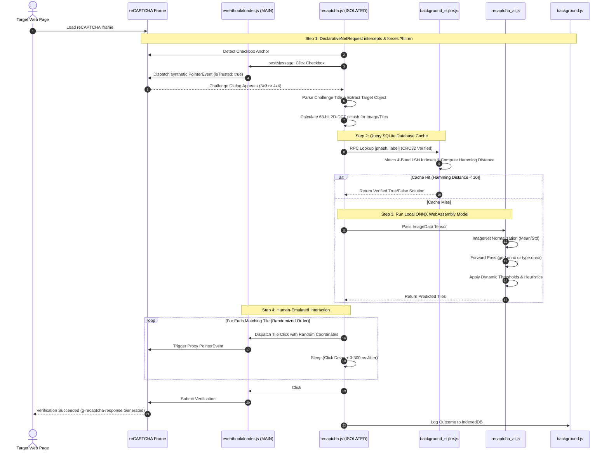

<p align="center">
  
</p>

<h1 align="center">MaiRec</h1>

<p align="center">
  <b>High-Performance On-Device reCAPTCHA v2 Solver & Distributed Remote Worker for Chromium Browsers</b>
</p>

<p align="center">
  <b>English</b> | <a href="README_zh-CN.md">简体中文</a> | <a href="README_ja.md">日本語</a>
</p>

<p align="center">
  <a href="#features"></a>
  <a href="#features"></a>
  <a href="#features"></a>
  <a href="#technical-architecture"></a>
  <a href="#technical-architecture"></a>
  <a href="LICENSE"></a>
  <a href="#privacy--telemetry-disclosure"></a>
</p>

---

## Table of Contents

- [Overview](#overview)
- [Key Features](#key-features)
- [Technical Architecture](#technical-architecture)
  - [System Topology](#system-topology)
  - [Solving Pipeline & Sequence](#solving-pipeline--sequence)
  - [Deep Dive into Core Components](#deep-dive-into-core-components)
- [Project Directory Structure](#project-directory-structure)
- [System Requirements & Permissions](#system-requirements--permissions)
- [Installation Guide](#installation-guide)
  - [Standard Extension Installation](#standard-extension-installation)
  - [Remote Worker (WS Addon) Installation](#remote-worker-ws-addon-installation)
- [Configuration & Settings](#configuration--settings)
- [Remote Control Mode (WS Addon)](#remote-control-mode-ws-addon)
- [Troubleshooting & FAQ](#troubleshooting--faq)
- [Privacy & Telemetry Disclosure](#privacy--telemetry-disclosure)
- [Contributing & Development](#contributing--development)
- [License & Disclaimer](#license--disclaimer)

---

## Overview

**MaiRec** is an advanced Google Chrome (Manifest V3) browser extension engineered to automatically solve Google reCAPTCHA v2 challenges completely on the client side. By bundling deep learning neural networks (ONNX format) and an embedded perceptual hash (pHash) database directly within the extension package, MaiRec executes fast, accurate visual recognition locally without relying on expensive, third-party pay-per-solve captcha APIs (such as 2Captcha or Anti-Captcha).

Whether you are performing web scraping, penetration testing, automated regression testing, or browsing the web, MaiRec provides a seamless, zero-cost, and private verification solution. In addition to local browsing automation, MaiRec includes a **WebSocket (WS) remote control worker layer** powered by the Chrome DevTools Protocol (CDP), allowing any browser instance to operate as a headless distributed solving node within automated pipelines.

---

## Key Features

- **100% Local Neural Network Inference**:
  - Executes deep convolutional neural networks directly in the browser via **ONNX Runtime Web** (WebAssembly backend with SIMD and multi-threading).
  - High accuracy classification on both 3×3 individual tiles and full 4×4 challenge grids.
- **Dual-Tier Resolution with pHash Acceleration**:
  - Bundles an embedded SQLite database (`db/captcha.sqlite`) containing **33,950+ pre-verified perceptual hashes**.
  - Calculates 63-bit 2D-DCT image perceptual hashes and queries the local database using Multi-Index Band Locality Sensitive Hashing (LSH) and Hamming distance matching ($< 10$ distance threshold).
  - Cache hits resolve in single-digit milliseconds without triggering neural network forward passes.
- **Comprehensive reCAPTCHA v2 Coverage**:
  - Automatically clicks "I'm not a robot" checkboxes.
  - Solves 3×3 single-selection and multi-selection challenges (including dynamic fading tile replacement).
  - Solves 4×4 grid boundary segmentation challenges (traffic lights, crosswalks, bridges, motorcycles).
- **Anti-Bot & Human Interaction Emulation**:
  - Injects a MAIN-world proxy loader that hooks `Element.prototype.addEventListener` to generate synthetic `PointerEvent` objects with genuine `isTrusted: true` property wrappers.
  - Fisher-Yates tile click shuffling to prevent robotic sequential clicking patterns.
  - Randomized coordinate offsets within element bounding boxes and non-deterministic timing jitter (0–300 ms).
- **Dynamic Network Language Rewriting (DNR)**:
  - Uses Chrome's `declarativeNetRequest` API to transparently append `hl=en` to reCAPTCHA subframe requests.
  - Eliminates classification failures caused by multilingual challenge prompts by normalizing challenge labels into standardized English categories.
- **Distributed Remote Worker Mode (WS Addon)**:
  - Transforms any Chrome instance into a dedicated, self-hosted solving agent.
  - Maintains persistent WebSocket communication via Chrome Offscreen Documents.
  - Intercepts requests via Chrome DevTools Protocol (CDP 1.3 `Fetch`/`Network` domain), injects lightweight solving templates, and returns verification tokens to central dispatchers.
- **Multilingual User Interface**:
  - Fully localized extension popup supporting 3 languages: Simplified Chinese, Japanese, and English, with dynamic switching and persistent storage.
- **macOS-Inspired Design System & Dynamic Theme Switching**:
  - Replicates native Apple System Settings with inset grouped cards, smooth toggle animations, and translucent surfaces.
  - Three distinct theme options: **System Theme**, **Dark Mode**, and **Light Mode**.
  - **System Theme (Auto-Detection)**: Automatically detects and follows the operating system's appearance preference (`prefers-color-scheme`). Live changes in the OS appearance take effect immediately without requiring browser or extension restarts.
  - **Manual Theme Switching & Persistence**: Instant theme toggling via the header toggle button or the theme dropdown in Solver Settings. Manual selections override the system preference until the user switches back to System Theme, and preferences persist across browser restarts.

---

## Technical Architecture

### System Topology

MaiRec employs a modular, decoupled architecture adhering to Chrome's Manifest V3 security boundaries:

```mermaid
flowchart TD
    subgraph BrowserContext["Chromium Browser Runtime (MV3)"]
        subgraph MainWorld["MAIN World (Web Page Context)"]
            Hook["eventhook/loader.js<br/>• Intercepts addEventListener<br/>• Spoofs isTrusted: true PointerEvents"]
            FrameWatch["ws/recaptcha_frame_watch.js<br/>• Monitors reCAPTCHA iframe errors & token generation"]
        end

        subgraph IsolatedWorld["ISOLATED World (Content Script)"]
            RC["captcha/recaptcha.js<br/>• DOM Observer & Challenge Orchestrator<br/>• Tile Slicing & Interaction Dispatcher"]
            AI["captcha/recaptcha_ai.js<br/>• ONNX Runtime Web WASM Engine<br/>• Tensor Preprocessing & Thresholding"]
            PHash["captcha/phash-browser.js<br/>• 2D-DCT Perceptual Hash Calculation"]
        end

        subgraph ServiceWorker["Background Service Worker"]
            BG["background.js<br/>• State Machine & DNR Language Rewrite<br/>• Salted CRC32 Message Verification"]
            SQL["background_sqlite.js<br/>• sql.js WebAssembly Engine<br/>• 4-Band LSH Hamming Lookup"]
            Uploader["uploader.js<br/>• Telemetry Packager (NDJSON Stream)"]
            WS_BG["ws/background_ws.js<br/>• CDP Session Controller<br/>• Request Interception & Template Injection"]
        end

        subgraph Offscreen["Offscreen Document"]
            WS_Client["ws/offscreen.js<br/>• Persistent WebSocket Client<br/>• Event-Loop Lag & Health Monitor"]
        end

        subgraph Storage["Sandbox & Local Storage"]
            SQLiteFile[("db/captcha.sqlite<br/>(33,950 Verified Hashes)")]
            IDB[("IndexedDB: caplog<br/>(Telemetry & Solving Records)")]
            SyncStorage[("chrome.storage.local<br/>(User Preferences)")]
        end
    end

    subgraph RemoteEndpoints["Remote Infrastructure (Optional)"]
        WSServer["Remote WebSocket Server<br/>(Task Distribution Server)"]
        GoogleServers["*.google.com/recaptcha/*<br/>(Official reCAPTCHA API)"]
    end

    %% Communication Links
    RC <-->|window.postMessage| Hook
    RC -->|Dynamic Import| AI
    RC -->|Dynamic Import| PHash
    RC <-->|chrome.runtime.sendMessage<br/>(CRC32 Salted)| BG
    BG --> SQL
    SQL --> SQLiteFile
    BG --> IDB
    BG --> SyncStorage
    WS_Client <-->|Internal RPC| WS_BG
    WS_Client <-->|WSS Connection| WSServer
    WS_BG <-->|CDP 1.3 Debugger| MainWorld
    MainWorld <--> GoogleServers
```

### Solving Pipeline & Sequence

The lifecycle of an automated challenge resolution follows a structured, multi-stage fallback pipeline:



### Deep Dive into Core Components

#### 1. Machine Learning Models (`extension/models/`)
- **`grid.onnx` (~26 MB)**:
  - Architecture: **EfficientNet-B1** backbone adapted for multi-label classification on full 4×4 challenge scenes (e.g., crosswalks, traffic lights, bridges).
  - Input: $240 \times 240 \times 3$ RGB tensor normalized by ImageNet statistics ($\mu = [0.485, 0.456, 0.406]$, $\sigma = [0.229, 0.224, 0.225]$).
  - Dynamic Thresholding: Guided by [`grid.meta.json`](extension/models/grid.meta.json), which specifies independent decision thresholds for each of the 16 grid cells to account for perspective distortion.
- **`motorcycles_b1.onnx` (~25 MB)**:
  - Specialized EfficientNet-B1 network tailored specifically for high-ambiguity motorcycle challenges.
- **`type.onnx` (~25 MB)**:
  - Multi-class image classifier evaluated on individual $100 \times 100$ cropped tiles for 3×3 challenges across 16 canonical object categories (bicycles, buses, cars, fire hydrants, crosswalks, stairs, chimneys, etc.).
- **Runtime Optimization**:
  - Utilizes WebAssembly SIMD (`ort-wasm-simd-threaded.jsep.wasm`) with dynamic thread allocation.
  - Concurrency safety enforced via a `WeakMap`-backed Promise serialization mutex (`runSafe`) to prevent memory race conditions inside WASM heaps.

#### 2. Perceptual Hashing & SQLite Cache (`extension/captcha/phash-browser.js` & `extension/background_sqlite.js`)
- **Algorithm**:
  1. Downsamples tile or challenge image to $32 \times 32$ grayscale using `OffscreenCanvas`.
  2. Applies a 2D Discrete Cosine Transform (2D-DCT) utilizing precomputed 32-order cosine lookup tables.
  3. Extracts the top-left $8 \times 8$ low-frequency transform matrix (excluding the DC coefficient $(0,0)$), yielding 63 AC coefficients.
  4. Computes the median value across the 63 coefficients and generates a 63-bit binary hash.
- **Database Indexing**:
  - Pre-populated SQLite database (`db/captcha.sqlite`, 6.5 MB) containing over 33,950 verified hashes.
  - 64-bit integer values are segmented into four 16-bit virtual column bands (`band0` to `band3`).
  - Six composite indexes (`band01`, `band02`, `band03`, `band12`, `band13`, `band23`) enable $O(1)$ candidate retrieval.
  - Candidates are filtered using a bitwise Brian Kernighan population count (`hamming64`) with a strict distance cutoff ($\le 9$).

#### 3. Event Hook & PointerEvent Proxy (`extension/eventhook/loader.js`)
- Standard programmatic JavaScript calls (`element.click()`, `dispatchEvent()`) produce events where `isTrusted = false`. Google reCAPTCHA inspects this property and immediately flags synthetic interactions.
- MaiRec injects `loader.js` into the page's `MAIN` execution world at `document_start`.
- Hooks `Element.prototype.addEventListener` using an ES6 `Proxy` to register and retain all internal event listeners within a `WeakMap`.
- When triggering actions, MaiRec constructs real native `PointerEvent` instances, wraps them in an accessor `Proxy` overriding `isTrusted` to return `true`, and directly invokes the underlying listener callbacks.

#### 4. Secure IPC Protocol
- Internal messages exchanged between Content Scripts and the Background Service Worker are protected using dynamic salted CRC32 authentication (`"b5b38eb8f40354127a85285f82a51f8b"` + microsecond nonce) to prevent unauthorized script tampering in untrusted page frames.

---

## Project Directory Structure

```text
MaiRec/
├── .gitignore                      # Git exclusion rules for builds, IDEs, and temp files
├── LICENSE                         # MIT License
├── README.md                       # English documentation
├── README_zh-CN.md                 # Simplified Chinese documentation
├── README_ja.md                    # Japanese documentation
├── MaiRec.png                      # Project icon / logo (512x512)
├── extension/                      # Main Chromium Extension (MV3)
│   ├── manifest.json               # Extension manifest (MV3, Permissions, Content Scripts, DNR)
│   ├── background.js               # Service Worker entry, DNR routing, IPC coordination
│   ├── background_sqlite.js        # SQLite WASM runtime and pHash LSH querying
│   ├── eventhook.js                # Content script messaging bridge
│   ├── uploader.js                 # Telemetry collector & NDJSON batch uploader
│   ├── popup.html                  # Extension popup user interface
│   ├── popup.js                    # Popup state manager and settings controller
│   ├── popup.css                   # Modern dark-theme styling
│   ├── i18n.js                     # Internationalization module & language manager
│   ├── reports.html                # Standalone reporting / API key interface
│   ├── reports.js                  # Reports controller
│   ├── _locales/                   # I18n localization resources (en, ja, zh)
│   │   ├── en/messages.json        # English locale strings
│   │   ├── ja/messages.json        # Japanese locale strings
│   │   └── zh/messages.json        # Simplified Chinese locale strings
│   ├── captcha/                    # Core captcha recognition algorithms
│   │   ├── recaptcha.js            # Challenge parser, DOM tracker, action sequencer
│   │   ├── recaptcha_ai.js         # ONNX Runtime model loader and tensor inference
│   │   └── phash-browser.js        # 2D-DCT perceptual hash computation engine
│   ├── db/
│   │   └── captcha.sqlite          # 6.5 MB SQLite database with 33,950+ verified hashes
│   ├── eventhook/
│   │   └── loader.js               # MAIN-world event hook & isTrusted proxy spoofer
│   ├── icon/                       # Action icons in standard resolutions (16, 32, 48, 128 px)
│   ├── lib/                        # WebAssembly glue & utility libraries
│   │   ├── selector.js             # CSS selector generator
│   │   ├── sql-wasm.js             # sql.js WebAssembly loader
│   │   ├── sql-wasm.mjs            # sql.js ES module wrapper
│   │   ├── sql-wasm.wasm           # SQLite WebAssembly binary (645 KB)
│   │   └── sql-wasm-wrapper.js     # sql.js module export wrapper
│   ├── libs/
│   │   └── onnxruntime-web/        # ONNX Runtime WebAssembly distribution
│   │       ├── ort.esm.js          # ONNX Runtime ES module interface
│   │       ├── ort-wasm-simd-threaded.jsep.mjs
│   │       └── ort-wasm-simd-threaded.jsep.wasm # ONNX WASM engine with SIMD (21 MB)
│   ├── models/                     # Deep learning neural network weights
│   │   ├── grid.onnx               # 4×4 EfficientNet-B1 model (26 MB)
│   │   ├── grid.meta.json          # 4×4 per-tile confidence thresholds
│   │   ├── motorcycles_b1.onnx     # 4×4 specialized motorcycle model (25 MB)
│   │   ├── motorcycles_b1.meta.json# Motorcycle per-tile thresholds
│   │   └── type.onnx               # 3×3 multi-class tile classifier (25 MB)
│   └── ws/                         # WebSocket remote worker integration
│       ├── background_ws.js        # WS controller, CDP debugger management, request interception
│       ├── offscreen.html          # Offscreen document host
│       ├── offscreen.js            # WebSocket client, watchdog, event-loop lag monitor
│       └── recaptcha_frame_watch.js# Frame watchdog for error and token detection
└── ws-addon/                       # Standalone WS Addon overlay package
    ├── README.md                   # Dedicated WS Addon setup and API guide
    ├── manifest.json               # Extended manifest (includes debugger & offscreen permissions)
    ├── icon/                       # Extension icons
    └── ws/                         # WS Addon source files
```

---

## System Requirements & Permissions

### System Requirements
- **Browser**: Google Chrome, Microsoft Edge, Brave, Opera, or any Chromium-based browser supporting **Manifest V3**.
  - Minimum Chrome Version: **116+** (required for `chrome.offscreen` and modern `chrome.debugger` APIs).
  - Base offline solver will function on **111+** if WS addon features are omitted.
- **Hardware**:
  - Multi-core CPU with WebAssembly SIMD instructions (x86_64 or ARM64 / Apple Silicon).
  - Approximately **150 MB – 300 MB** of free browser memory during peak neural network inference.

### Manifest Permissions Explained

| Permission | Scope | Purpose |
|---|---|---|
| `alarms` | Background | Drives periodic telemetry flushes and connection keep-alive checks. |
| `declarativeNetRequest` | Network | Dynamically appends `hl=en` query parameter to Google reCAPTCHA subframes without reading sensitive web traffic. |
| `idle` | System | Detects browser idle states to perform background database sync without impacting active browsing. |
| `storage` | Browser | Persists user settings, disabled hostnames, and solving timeouts locally. |
| `tabs` | Tabs | Manages tab lifecycles when running in remote worker mode. |
| `debugger` | CDP 1.3 | Enables Chrome DevTools Protocol for fast network interception and template injection in remote solving mode. |
| `offscreen` | Window | Runs a hidden offscreen document to maintain a persistent WebSocket connection immune to Service Worker sleep cycles. |
| `host_permissions` | Web | Targets `*://*.google.com/recaptcha/*` and `*://*.recaptcha.net/recaptcha/*` (plus `<all_urls>` for remote worker interception). |

---

## Installation Guide

### Standard Extension Installation

1. Clone or download the repository to your local machine:
   ```bash
   git clone https://github.com/Melony-mai/MaiRec.git
   cd MaiRec
   ```
2. Open Google Chrome (or any Chromium browser) and navigate to:
   ```text
   chrome://extensions
   ```
3. Enable **Developer mode** using the toggle switch in the top-right corner.
4. Click the **Load unpacked** button in the top-left corner.
5. In the file picker dialog, select the `extension/` folder inside the project directory.
6. The **MaiRec** extension will appear in your installed extensions list.
7. *(Recommended)* Pin the extension to your browser toolbar for easy configuration.

> [!NOTE]
> **Proactive Background Warm-up**: MaiRec automatically initializes and pre-warms the WebAssembly runtime and ONNX models in the background when the browser starts. When your first CAPTCHA challenge arrives, the engine is already warm, executing inferences instantly in ~180 ms.

---

### Remote Worker (WS Addon) Installation

If you intend to use MaiRec as a distributed headless solving node for external pipelines:

1. Follow the standard installation steps above.
2. The `extension/` directory in this repository already includes the unified WebSocket and offscreen components.
3. Open the extension popup, navigate to the **Reports** section, and enter your 32-character API key.
4. Toggle **WS mode** on.
5. The extension will automatically spawn an offscreen document and connect to the remote dispatcher.

---

## Configuration & Settings

Click on the extension icon in your browser toolbar to open the settings panel:

<p align="center">
  
</p>

The popup interface is logically organized into two primary sections: **Solver Settings** and **Timeout Settings / Report**, along with quick-access submenus for timeout calibrations and reporting status.

### 1. Solver Settings

| Option | Default | Description |
|---|---|---|
| **Language** | `English` | Choose extension interface language (English, 日本語, or 简体中文). Preferences persist across browser sessions. |
| **Theme** | `Dark` | Switch between **System Theme**, **Dark Mode**, and **Light Mode**. When set to System Theme, the extension automatically detects and follows the operating system's appearance preference in real time without restart. Manual Light or Dark selections override the system preference until switched back to System Theme. |
| **Solver enabled** | `On` | Global master toggle for all extension solving features. |
| **reCAPTCHA support** | `On` | Enables or disables interception of Google reCAPTCHA challenges. |
| **Auto-click buttons** | `On` | Automatically clicks the "I'm not a robot" checkbox when detected. |
| **Solve image challenges** | `On` | Automatically identifies and clicks required challenge tiles using local ONNX neural models. |

### 2. Timeout Settings / Report

This section groups remote worker connectivity with reporting and timing configurations:

| Option / Control | Default | Description |
|---|---|---|
| **WS mode** | `Off` | Connects the browser to a remote WebSocket server as an automated worker node. Relocated to this section alongside reporting configurations; requires a 32-character API key configured in Reports. |
| **Timeouts** | Button | Opens the Timeouts submenu to adjust human-emulation delays. |
| **Reports** | Button | Opens the Reports submenu to view delivery statuses and configure the 16/32-character API key. |

### Timeouts & Human Emulation (Timeouts Submenu)

| Timing Parameter | Default | Range | Description |
|---|---|---|---|
| **Between tile clicks** | `300 ms` | $0 - 5000\text{ ms}$ | Pause between successive tile clicks in 3×3 challenges. |
| **Dynamic reveal → click** | `850 ms` | $0 - 5000\text{ ms}$ | Delay before clicking a new tile that appeared dynamically (compensates for recognition time). |
| **Last click → verify** | `850 ms` | $0 - 5000\text{ ms}$ | Pause between selecting the final tile and pressing the "Verify" button. |

> [!TIP]
> A random jitter of **0–300 ms** is automatically appended to every timeout execution, and tiles in 3×3 challenges are clicked in randomized order to emulate realistic human behavior.

---

## Remote Control Mode (WS Addon)

When running in **WS Addon** mode, MaiRec operates as a dedicated solving worker:

1. **Persistent Connection**: An offscreen document (`ws/offscreen.html`) establishes a secure WebSocket connection to your dispatch server that remains active even when the Service Worker enters sleep mode.
2. **Performance Telemetry**: The worker continuously measures event loop drift (P50, P95, P99 latency) and reports browser health to the dispatcher, ensuring tasks are routed only to responsive nodes.
3. **CDP Interception**:
   - Upon receiving a task (`{ url, sitekey }`), a controlled browser tab is created.
   - `chrome.debugger` attaches to the tab and enables `Fetch.requestPaused`.
   - The original document response is intercepted and replaced with a zero-overhead HTML shell containing `grecaptcha.render()`.
   - All unrelated network requests (images, tracking scripts, third-party fonts) are blocked, minimizing resource usage.
   - Once solved, the generated `g-recaptcha-response` token is returned via WebSocket, the tab displays `"WELL DONE"`, and is immediately recycled.

The remote protocol is fully compatible with standard 2Captcha and Anti-Captcha task dispatchers.

---

## Troubleshooting & FAQ

#### 1. How is initial model cold-start eliminated?
In earlier releases, WebAssembly SIMD binaries and ONNX models were loaded on-demand when the first CAPTCHA appeared, causing an initial delay. MaiRec now features an asynchronous background warm-up engine running in a persistent offscreen document: upon browser launch, all neural models (`type.onnx`, `grid.onnx`, `motorcycles_b1.onnx`) are preloaded and warmed up with dummy inferences without delaying browser startup. The first CAPTCHA solve executes at full operational speed (~180 ms).

#### 2. Why does a yellow banner stating "MaiRec started debugging this browser" appear?
This banner is a built-in Chrome security requirement whenever an extension utilizes the `chrome.debugger` API. It only appears when **WS mode** (remote control) is active. The standard offline extension does not trigger this banner.

#### 3. What if a website displays captchas in a language other than English?
MaiRec includes a `declarativeNetRequest` rule that automatically injects `hl=en` into reCAPTCHA subframes. Ensure you have not disabled extension permissions or installed conflicting network rewrite extensions.

#### 4. Can MaiRec run completely offline?
Yes. The computer vision models and SQLite perceptual hash database are stored locally on your machine. However, loading the actual reCAPTCHA challenge still requires an active internet connection to communicate with Google's servers.

---

## Privacy & Telemetry Disclosure

MaiRec is committed to transparent data handling:

- **Local Inference**: All image processing, neural network inferences, and perceptual hash lookups occur 100% locally on your device CPU via WebAssembly. **No captcha images are sent to external servers for solving.**
- **Privacy Enforcement**:
  - Remote telemetry data uploads are permanently disabled to ensure complete user privacy and eliminate cloud leakage.
  - No personally identifiable information (PII), browsing history, cookies, or account credentials are ever collected or transmitted.
  - The local database and models operate entirely within the browser sandbox.

---

## Contributing & Development

Contributions, bug reports, and pull requests are welcome!

### Direct Repository Synchronization & Popup UI Integration

MaiRec provides a built-in automated synchronization engine accessible both directly through the **"Check for Updates" button in the extension popup interface** and via command-line tooling (`npm run sync` / `./sync.sh`) that connects directly with the upstream GitHub repository (`https://github.com/Melony-mai/MaiRec.git`) to keep your local workspace up-to-date without requiring manual re-downloads or re-cloning:

```bash
# Direct synchronization with upstream GitHub main branch
npm run sync

# Or using the root shortcut script
./sync.sh

# Inspect sync status and incoming commits without applying changes
npm run sync:check

# Start local synchronization bridge service for extension integration
npm run sync:server
```

**Key Safety Guarantees & UI Features:**
- **In-Popup One-Click Update & Status**: Click the "Check for Updates" button next to the version badge in the popup header to check GitHub in real time. When updates are available, the button highlights as "Update Now" to synchronize directly, displaying clear status indicators (`Up to date`, `Checking...`, `Update available`, or `Update failed`).
- **Zero Work Loss**: Uncommitted modifications, staged files, and untracked files are automatically detected and safely preserved in Git stash before any remote changes are integrated.
- **Direct Remote Iteration**: Automatically fetches and merges latest upstream commits directly into your local working branch.
- **Safe Merge Conflict Handling**: If conflicts occur between incoming remote changes and local edits, MaiRec halts safely without clobbering files, preserves all work, and clearly reports conflicted files with actionable guidance.
- **Automatic Health & Regression Verification**: Automatically runs project manifest checks, dependency integrity checks, and the automated test suite (`npm test`) immediately after synchronization to ensure the codebase remains fully operational.

### Development Workflow

1. Fork the repository on GitHub.
2. Synchronize with the latest upstream repository:
   ```bash
   npm run sync
   ```
3. Create a dedicated feature branch:
   ```bash
   git checkout -b feature/model-optimization
   ```
4. Run the automated test suite:
   ```bash
   npm test
   ```
5. Commit your changes with clear, descriptive commit messages:
   ```bash
   git commit -m "feat(ai): optimize thresholding heuristics for crosswalks"
   ```
6. Push your branch:
   ```bash
   git push origin feature/model-optimization
   ```
7. Open a Pull Request detailing your enhancements.

---

## License & Disclaimer

### License
This project is open-source software licensed under the [MIT License](LICENSE).

### Disclaimer
This software is developed and distributed strictly for educational, security auditing, and accessibility research purposes. Users are solely responsible for ensuring their usage complies with relevant terms of service, applicable laws, and regulations. The authors assume no liability for misuse.
