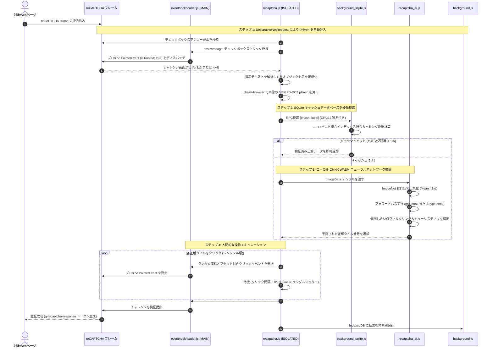

<p align="center">
  
</p>

<h1 align="center">MaiRec</h1>

<p align="center">
  <b>Chromium系ブラウザ向け 高性能オンデバイス reCAPTCHA v2 自動解決ツール＆分散リモートワーカー</b>
</p>

<p align="center">
  <a href="README.md">English</a> | <a href="README_zh-CN.md">简体中文</a> | <b>日本語</b>
</p>

<p align="center">
  <a href="#主な機能"></a>
  <a href="#主な機能"></a>
  <a href="#主な機能"></a>
  <a href="#技術アーキテクチャと内部構造"></a>
  <a href="#技術アーキテクチャと内部構造"></a>
  <a href="LICENSE"></a>
  <a href="#プライバシーとデータ収集に関する開示"></a>
</p>

---

## 目次

- [プロジェクト概要](#プロジェクト概要)
- [主な機能](#主な機能)
- [技術アーキテクチャと内部構造](#技術アーキテクチャと内部構造)
  - [システムトポロジー](#システムトポロジー)
  - [解決パイプラインとシーケンス](#解決パイプラインとシーケンス)
  - [主要コンポーネント詳細](#主要コンポーネント詳細)
- [プロジェクト構成](#プロジェクト構成)
- [動作要件と権限](#動作要件と権限)
- [インストール手順](#インストール手順)
  - [標準拡張機能のインストール（ローカル自動化）](#標準拡張機能のインストールローカル自動化)
  - [リモートワーカーのインストール（WSアドオンモード）](#リモートワーカーのインストールwsアドオンモード)
- [設定とチューニング](#設定とチューニング)
- [リモートコントロールモード (WS Addon)](#リモートコントロールモード-ws-addon)
- [トラブルシューティングとよくある質問](#トラブルシューティングとよくある質問)
- [プライバシーとデータ収集に関する開示](#プライバシーとデータ収集に関する開示)
- [コントリビューションと開発](#コントリビューションと開発)
- [ライセンスと免責事項](#ライセンスと免責事項)

---

## プロジェクト概要

**MaiRec** は、Google Chrome の **Manifest V3 (MV3)** 規格に準拠して設計された高機能ブラウザ拡張機能であり、Google reCAPTCHA v2 の画像認証チャレンジを**完全にクライアント端末上（ローカル）**で自動識別・解決します。ディープラーニング畳み込みニューラルネットワーク（ONNX形式）と組み込み型知覚ハッシュ（pHash）データベースを拡張機能内にパッケージ化しているため、2Captcha や Anti-Captcha などの外部有料打鍵サービス API に一切依存することなく、ミリ秒単位の高速画像認識とローカル推論を実現します。

Webスクレイピング、ペネトレーションテスト、自動回帰テスト、あるいは日常的なWebブラウジングでの認証操作の自動化において、MaiRec は完全無料・超低遅延・高プライバシーな解決策を提供します。さらに、**Chrome DevTools Protocol (CDP)** を活用した **WebSocket (WS) リモートコントロールレイヤー** を備えており、あらゆるブラウザインスタンスを自動化パイプライン内の分散型解決ワーカーノードとしてシームレスに運用できます。

---

## 主な機能

- **100% ローカルニューラルネットワーク推論**:
  - **ONNX Runtime Web**（SIMDおよびマルチスレッド対応のWebAssemblyバックエンド）により、ブラウザサンドボックス内で直接推論を実行。
  - 3×3 の独立タイル物体分類および 4×4 の全体グリッド境界セグメンテーションに対応。
- **知覚ハッシュ（pHash）による二段階高速化キャッシュ**:
  - 組み込みSQLiteデータベース（`db/captcha.sqlite`）に **33,950件以上の検証済みハッシュ** を収録。
  - 63ビット 2D-DCT アルゴリズムにより知覚ハッシュを計算し、マルチインデックス・バンド分割局所性鋭敏型ハッシュ（LSH）とハミング距離照合（閾値 $< 10$）で高速検索。
  - キャッシュヒット時はニューラルネットワークを起動することなくミリ秒単位で即座に回答し、CPU消費を大幅に削減。
- **reCAPTCHA v2 の全チャレンジ形式を網羅**:
  - 「私はロボットではありません」チェックボックス（Checkbox）の自動検出とクリック。
  - 3×3 静的タイルおよび動的フェードイン・フェードアウト（Dynamic Fading Tiles）チャレンジの自動解決。
  - 4×4 グリッドシーン境界チャレンジ（信号機、横断歩道、橋、オートバイなど）の自動判別。
- **対Bot検知回避と人間的な操作エミュレーション**:
  - Webページのネイティブ実行環境（MAIN World）にプロキシローダーを注入し、`Element.prototype.addEventListener` をフックして `isTrusted: true` を返す合成 `PointerEvent` を生成。
  - Fisher–Yatesシャッフルアルゴリズムによりタイルのクリック順序をランダム化し、機械的なクリックパターンを排除。
  - 要素のバウンディングボックス内でランダムな座標オフセットを算出し、0〜300msの非決定論的なジッター（遅延の揺らぎ）を挿入。
- **動的ネットワーク言語リライティング (DNR)**:
  - Chrome の `declarativeNetRequest` API を使用し、reCAPTCHA サブフレームのリクエストに自動的に `hl=en` を付加。
  - チャレンジの言語を標準英語ラベルに統一することで、多言語プロンプトによる認識ミスを防止。
- **分散型リモート解決ワーカーノード (WS Addon)**:
  - Chrome ブラウザを自動化クラスタの専用ワーカーノードへ変換可能。
  - Chrome Offscreen Document を利用して持続的な WebSocket 接続を維持（Service Worker の自動スリープを回避）。
  - CDP 1.3 の `Fetch` ドメインにより不要なアセットリクエストを遮断し、軽量テンプレートを注入してトークンを取得・返送。
- **多言語対応のポップアップUI**:
  - ポップアップ設定画面は3言語をネイティブサポート：日本語、英語、簡体字中国語。動的切り替えおよびブラウザ再起動時の設定永続化に対応。

---

## 技術アーキテクチャと内部構造

### システムトポロジー

MaiRec は、Chrome MV3 のセキュリティ境界に適合したモジュール設計とハイブリッド実行アーキテクチャを採用しています：

```mermaid
flowchart TD
    subgraph BrowserContext["Chromium ブラウザ実行環境 (MV3)"]
        subgraph MainWorld["MAIN ワールド (ページネイティブ環境)"]
            Hook["eventhook/loader.js<br/>• addEventListener のフック<br/>• isTrusted: true の PointerEvent 偽装"]
            FrameWatch["ws/recaptcha_frame_watch.js<br/>• reCAPTCHA エラーと Token 生成の監視"]
        end

        subgraph IsolatedWorld["ISOLATED ワールド (拡張機能コンテンツスクリプト)"]
            RC["captcha/recaptcha.js<br/>• DOM状態管理・チャレンジ調停<br/>• 画像スライス・クリックアクション発行"]
            AI["captcha/recaptcha_ai.js<br/>• ONNX Runtime Web WASM 推論エンジン<br/>• テンソル正規化・しきい値フィルタリング"]
            PHash["captcha/phash-browser.js<br/>• 2D-DCT 知覚ハッシュ計算モジュール"]
        end

        subgraph ServiceWorker["Background Service Worker (バックグラウンド)"]
            BG["background.js<br/>• 状態調停 / DNR 英語強制リダイレクト<br/>• ソルト付き CRC32 IPC署名検証"]
            SQL["background_sqlite.js<br/>• sql.js WebAssembly データベースサービス<br/>• 4-Band LSH ハミング距離検索"]
            Uploader["uploader.js<br/>• テレメトリ収集（NDJSONバッチ転送）"]
            WS_BG["ws/background_ws.js<br/>• CDP セッション中枢<br/>• リクエスト傍受・軽量テンプレート注入"]
        end

        subgraph Offscreen["Offscreen ドキュメント"]
            WS_Client["ws/offscreen.js<br/>• 常駐型 WebSocket クライアント<br/>• イベントループ遅延＆ヘルス監視"]
        end

        subgraph Storage["サンドボックスとローカルストレージ"]
            SQLiteFile[("db/captcha.sqlite<br/>(33,950件以上の検証済みハッシュ)")]
            IDB[("IndexedDB: caplog<br/>(解決ログ・画像スライス保存)")]
            SyncStorage[("chrome.storage.local<br/>(ユーザー設定)")]
        end
    end

    subgraph RemoteEndpoints["リモートエンドポイント (任意)"]
        WSServer["wss://ws.captcharaptor.com<br/>(分散タスクディスパッチャ)"]
        TelemetryServer["https://captcharaptor.com/upload.php<br/>(モデル学習データ収集エンドポイント)"]
        GoogleServers["*.google.com/recaptcha/*<br/>(Google reCAPTCHA 公式サービス)"]
    end

    %% 接続関係
    RC <-->|window.postMessage| Hook
    RC -->|動的 import| AI
    RC -->|動的 import| PHash
    RC <-->|chrome.runtime.sendMessage<br/>(CRC32 ソルト検証)| BG
    BG --> SQL
    SQL --> SQLiteFile
    BG --> IDB
    BG --> SyncStorage
    Uploader --> IDB
    Uploader -.->|NDJSON バッチ転送| TelemetryServer
    WS_Client <-->|内部 RPC 通信| WS_BG
    WS_Client <-->|WSS 接続| WSServer
    WS_BG <-->|CDP 1.3 Debugger| MainWorld
    MainWorld <--> GoogleServers
```

### 解決パイプラインとシーケンス

認証の自動解決は、以下のフォールバック付きパイプラインに沿って実行されます：



### 主要コンポーネント詳細

#### 1. 深層学習ニューラルネットワーク (`extension/models/`)
- **`grid.onnx` (~26 MB)**:
  - アーキテクチャ: **EfficientNet-B1** をベースとし、4×4 全体画像マルチラベル分類（横断歩道、信号機、橋など）向けに最適化。
  - 入力: $240 \times 240 \times 3$ RGB テンソル。ImageNet 統計量（$\mu = [0.485, 0.456, 0.406]$, $\sigma = [0.229, 0.224, 0.225]$）により正規化。
  - 動的しきい値: [`grid.meta.json`](extension/models/grid.meta.json) に基づき、パースペクティブ歪みを補正するため 16 グリッド個別の信頼度しきい値を適用。
- **`motorcycles_b1.onnx` (~25 MB)**:
  - 誤認率の高いオートバイのチャレンジに特化してファインチューニングされた EfficientNet-B1 モデル。
- **`type.onnx` (~25 MB)**:
  - 3×3 チャレンジの独立 $100 \times 100$ スライスタイル向け多クラス分類器（自転車、バス、車、消火栓、階段、煙突など主要16カテゴリに対応）。
- **WASM 最適化と排他制御**:
  - SIMD およびマルチスレッドを有効化した `ort-wasm-simd-threaded.jsep.wasm` をロード。
  - `WeakMap` と Promise チェーンによる排他制御（`runSafe`）を実装し、WebAssembly メモリの並行アクセス破壊を完全に防止。

#### 2. 知覚ハッシュ＆SQLiteキャッシュエンジン (`phash-browser.js` & `background_sqlite.js`)
- **知覚ハッシュ算出アルゴリズム**:
  1. `OffscreenCanvas` を介して画像を $32 \times 32$ グレースケールに縮小。
  2. 事前計算済みの32次余弦テーブルを用いて高速な2次元離散コサイン変換（2D-DCT）を実行。
  3. 直流成分 $(0,0)$ を除く左上 $8 \times 8$ の低周波領域（交流成分63個）を抽出。
  4. 63個の係数の中央値を求め、中央値以上を `1`、未満を `0` とする 63bit バイナリハッシュを生成。
- **データベース検索**:
  - 組み込みデータベース `db/captcha.sqlite`（約 6.5 MB）に 33,950件以上の正解ハッシュを保持。
  - 64bit 値を4つの 16bit 仮想バンド列（`band0`〜`band3`）に分割し、6組の複合インデックスで候補を $O(1)$ 抽出。
  - JS 側で Brian Kernighan 法による正確なハミング距離を計算し、距離が 10 未満のものを同一画像として判定。

#### 3. イベントフックと PointerEvent プロキシ偽装 (`extension/eventhook/loader.js`)
- 通常の `element.click()` 等のスクリプト生成イベントは `isTrusted: false` となり、reCAPTCHA のボット検知によって即座に拒絶されます。
- MaiRec は `document_start` のタイミングで `loader.js` をページ原生の **MAIN ワールド** に注入します。
- ES6 `Proxy` を使用して `Element.prototype.addEventListener` をフックし、登録されるリスナーコールバックを `WeakMap` に保持します。
- クリック操作時はネイティブ `PointerEvent` を生成し、Proxy 経由で `isTrusted` プロパティが `true` を返すよう偽装して実行します。

#### 4. 安全なプロセス間通信プロトコル (IPC)
- コンテンツスクリプトと Service Worker 間のメッセージ送受信は、共有ソルト文字列（`"b5b38eb8f40354127a85285f82a51f8b"`）とミリ秒ナンスによる動的 CRC32 署名で検証され、第三者スクリプトによる不正な RPC 呼び出しを防止します。

---

## プロジェクト構成

```text
captchaplugin-main/
├── .gitignore                      # Git 除外設定（環境設定、IDE、ビルド成果物）
├── LICENSE                         # MIT ライセンス
├── README.md                       # 英語ドキュメント（メイン）
├── README_zh-CN.md                 # 簡体字中国語ドキュメント
├── README_ja.md                    # 日本語ドキュメント
├── MaiRec.png                      # プロジェクトロゴ・バナー (512x512)
├── extension/                      # Chrome MV3 拡張機能の本体ディレクトリ
│   ├── manifest.json               # 拡張機能マニフェスト（権限、スクリプト、DNR設定）
│   ├── background.js               # Service Worker バックグラウンドメイン処理
│   ├── background_sqlite.js        # SQLite WebAssembly 検索サービス
│   ├── eventhook.js                # コンテンツスクリプト通信ブリッジ
│   ├── uploader.js                 # テレメトリ収集＆NDJSONバッチ転送
│   ├── popup.html                  # ポップアップ設定UI
│   ├── popup.js                    # ポップアップ制御ロジック
│   ├── popup.css                   # ダークテーマスタイルシート
│   ├── i18n.js                     # 国際化言語マネージャー＆多言語翻訳定義
│   ├── reports.html                # レポート／API Key 設定UI
│   ├── reports.js                  # レポート設定ロジック
│   ├── _locales/                   # 多言語対応の国際化リソース（en, ja, zh）
│   │   ├── en/messages.json        # 英語リソース
│   │   ├── ja/messages.json        # 日本語リソース
│   │   └── zh/messages.json        # 簡体字中国語リソース
│   ├── captcha/                    # コア画像認識アルゴリズム
│   │   ├── recaptcha.js            # チャレンジ監視、画像スライス、操作シーケンス
│   │   ├── recaptcha_ai.js         # ONNX Runtime モデル読み込みと推論処理
│   │   └── phash-browser.js        # 2D-DCT 知覚ハッシュ算出モジュール
│   ├── db/
│   │   └── captcha.sqlite          # 3.3万件超の検証済みハッシュを含む SQLite DB (6.5 MB)
│   ├── eventhook/
│   │   └── loader.js               # MAINワールド注入スクリプト（isTrusted 偽装）
│   ├── icon/                       # アクションアイコン（16, 32, 48, 128 px）
│   ├── lib/                        # WebAssembly および補助ライブラリ
│   │   ├── selector.js             # CSS セレクタ逆生成モジュール
│   │   ├── sql-wasm.js             # sql.js WebAssembly ローダー
│   │   ├── sql-wasm.mjs            # sql.js ES モジュール
│   │   ├── sql-wasm.wasm           # SQLite WebAssembly バイナリ (645 KB)
│   │   └── sql-wasm-wrapper.js     # sql.js ラッパー
│   ├── libs/
│   │   └── onnxruntime-web/        # ONNX Runtime 公式配布パッケージ
│   │       ├── ort.esm.js          # ONNX Runtime ES モジュールインターフェース
│   │       ├── ort-wasm-simd-threaded.jsep.mjs
│   │       └── ort-wasm-simd-threaded.jsep.wasm # ONNX WASM エンジン (21 MB)
│   ├── models/                     # 機械学習モデルのウェイトファイル
│   │   ├── grid.onnx               # 4×4 EfficientNet-B1 グリッドモデル (26 MB)
│   │   ├── grid.meta.json          # 4×4 グリッドセル別しきい値設定
│   │   ├── motorcycles_b1.onnx     # 4×4 オートバイ専用モデル (25 MB)
│   │   ├── motorcycles_b1.meta.json# オートバイ個別しきい値設定
│   │   └── type.onnx               # 3×3 タイル分類モデル (25 MB)
│   └── ws/                         # WebSocket リモートワーカーモジュール
│       ├── background_ws.js        # WS モード制御（CDP デバッガ・リクエスト傍受）
│       ├── offscreen.html          # 離屏ドキュメントコンテナ
│       ├── offscreen.js            # WebSocket クライアント・監視ロジック
│       └── recaptcha_frame_watch.js# フレーム内エラー＆トークン監視スクリプト
└── ws-addon/                       # WS アドオン用の差分オーバーレイパッケージ
    ├── README.md                   # WS アドオン専用セットアップガイド
    ├── manifest.json               # 拡張マニフェスト（debugger, offscreen 権限追加版）
    ├── icon/                       # アイコン画像
    └── ws/                         # アドオンソースコード
```

---

## 動作要件と権限

### 動作環境
- **対応ブラウザ**: Google Chrome、Microsoft Edge、Brave、Opera、その他 **Manifest V3** 対応の Chromium 系ブラウザ。
  - 推奨バージョン: **Chrome 116+**（`chrome.offscreen` および CDP による完全なリモート機能に必要）。
  - ローカル自動解決機能のみ利用する場合は **Chrome 111+** でも動作します。
- **ハードウェア要件**:
  - WebAssembly SIMD 命令をサポートするマルチコア CPU（x86_64 または ARM64 / Apple Silicon）。
  - 推論実行時に約 **150 MB 〜 300 MB** の空きメモリ。

### マニフェスト権限の説明

| 権限名 | 実行コンテキスト | 用途と必要性 |
|---|---|---|
| `alarms` | Background | 定期的なテレメトリ同期および WebSocket キープアライブ監視。 |
| `declarativeNetRequest` | Network | センシティブな通信内容を閲覧することなく、reCAPTCHA リクエストに自動的に `hl=en` を注入。 |
| `idle` | System | ブラウザのアイドル状態を検出し、通常利用の帯域を圧迫せずにバックグラウンド同期を実行。 |
| `storage` | Browser | ユーザー設定、タイムアウト設定、無効化ドメインのローカル保存。 |
| `tabs` | Tabs | リモートワーカーモード時のタブ生成・操作・クローズ処理。 |
| `debugger` | CDP 1.3 | Chrome DevTools Protocol による高速リクエスト傍受と軽量テンプレート注入。 |
| `offscreen` | Window | Service Worker の自動休眠を受けない常駐 WebSocket クライアントの維持。 |
| `host_permissions` | Web | `*://*.google.com/recaptcha/*` および `*://*.recaptcha.net/recaptcha/*`（WSモード時は `<all_urls>`）。 |

---

## インストール手順

### 標準拡張機能のインストール（ローカル自動化）

1. 本リポジトリをローカルにクローンします：
   ```bash
   git clone https://github.com/Melony-mai/MaiRec.git
   cd MaiRec
   ```
2. Chrome ブラウザを開き、アドレスバーに以下を入力して移動します：
   ```text
   chrome://extensions
   ```
3. 画面右上の **デベロッパー モード (Developer mode)** を有効にします。
4. 画面左上に表示される **パッケージ化されていない拡張機能を読み込む (Load unpacked)** をクリックします。
5. ファイル選択ダイアログで、プロジェクト内の **`extension/`** フォルダを選択します。
6. インストールが完了すると、拡張機能一覧に **MaiRec** が表示されます。
7. *(推奨)* ツールバーのパズルアイコンから MaiRec をピン留めしておくと便利です。

> [!NOTE]
> 初回起動時、WASM の JIT コンパイルと ONNX モデルのメモリ展開により、最初の認証チャレンジで 5〜15秒の初期化時間を要する場合があります。一度メモリに読み込まれれば、以降はミリ秒単位で高速に動作します。

---

### リモートワーカーのインストール（WSアドオンモード）

ブラウザインスタンスを自動化クラスタの分散解決ワーカーとして運用する場合：

1. 上記の手順に従って `extension/` フォルダを読み込みます（現在の `extension/` には統合版 WS モジュールが既に含まれています）。
2. 拡張機能ポップアップを開き、**Reports** 画面に移動します。
3. 32桁のワーカー API キーを入力し、**WS mode** を有効化します。
4. 自動的に Offscreen ドキュメントが生成され、ディスパッチサーバーとの接続が確立されます。

---

## 設定とチューニング

ブラウザツールバーの MaiRec アイコンをクリックすると、設定画面が表示されます：

<p align="center">
  
</p>

ポップアップ設定パネルは論理的に2つの主要セクション「**ソルバー設定**」と「**タイムアウト設定 / レポート**」に整理されており、詳細な遅延調整やレポート送信状態の確認を行うサブメニューを備えています。

### 1. ソルバー設定

| 項目 | デフォルト | 説明 |
|---|---|---|
| **Language** | `English` | 拡張機能のUI言語を手動選択（English、日本語、简体中文の3言語対応、ブラウザ再起動後も設定を維持）。 |
| **Solver enabled** | `ON` | 拡張機能全体のマスター有効/無効スイッチ。 |
| **reCAPTCHA support** | `ON` | Google reCAPTCHA 認証の自動検知と解決の有効化。 |
| **Auto-click buttons** | `ON` | チェックボックスを検出した際、「私はロボットではありません」を自動クリック。 |
| **Solve image challenges** | `ON` | 画像認証が表示された際、ローカルの ONNX モデルにより正解タイルを自動判定してクリック・送信。 |

### 2. タイムアウト設定 / レポート

リモートワーカー連携とレポート、遅延設定を論理的に統合したセクションです：

| 項目 / コントロール | デフォルト | 説明 |
|---|---|---|
| **WS mode** | `OFF` | WebSocket リモート解決クラスタへの接続スイッチ。本セクション（タイムアウト設定 / レポート）に再配置。利用にはレポート画面で32文字の有効な API キーの設定が必要です。 |
| **タイムアウト (Timeouts)** | ボタン | 人間的な操作遅延を調整する Timeouts サブメニューを開きます。 |
| **レポート (Reports)** | ボタン | 送信状態の確認や 16/32 文字の API キーを設定する Reports サブメニューを開きます。 |

### タイムアウトと人間的遅延設定 (Timeouts サブメニュー)

| パラメータ | デフォルト値 | 調整範囲 | 説明 |
|---|---|---|---|
| **Between tile clicks** | `300 ms` | $0 - 5000\text{ ms}$ | 3×3 チャレンジで各タイルを連続してクリックする際の間隔。 |
| **Dynamic reveal → click** | `850 ms` | $0 - 5000\text{ ms}$ | 動的フェード画像が出現してから再度クリックするまでの待機時間（認識処理時間を内包）。 |
| **Last click → verify** | `850 ms` | $0 - 5000\text{ ms}$ | 最後の正解タイルを選択してから「確認 (Verify)」ボタンを押すまでの安全待機時間。 |

> [!TIP]
> タイマー実行ごとに **0〜300 ms** のランダムなジッターが自動加算され、3×3 チャレンジではタイルのクリック順序がシャッフルされるため、人間らしい自然な操作パターンが維持されます。

---

## リモートコントロールモード (WS Addon)

**WS モード** を有効化すると、MaiRec は専用の自動解決ワーカーとして動作します：

1. **持続的接続の維持**: Offscreen ドキュメント（`ws/offscreen.html`）を介して `wss://ws.captcharaptor.com` と接続し、MV3 バックグラウンドスクリプトのサスペンドを回避します。
2. **イベントループ健全性監視**: メインスレッドのジッター（P50、P95、P99 レイテンシ）を測定し、ハートビートと共に送信することで、高負荷状態のブラウザへのタスク過剰割り振りを防止します。
3. **CDP による高速サンドボックス化**:
   - 解決タスク（`{ url, sitekey }`）を受信すると、制御用タブを生成。
   - `chrome.debugger` でアタッチし、`Fetch.requestPaused` を有効化。
   - 対象ページの Document を極小の HTML テンプレートに差し替え、`grecaptcha.render()` のみをピンポイントで実行。
   - 余分な広告、トラッカー、画像等の通信を遮断し、リソース消費を最小化。
   - 解決後、取得した `g-recaptcha-response` トークンを WebSocket 経由で返却し、タブを自動破棄。

このプロトコルは、一般的な 2Captcha および AntiCaptcha 互換の API 形式でタスクを受領可能です。

---

## トラブルシューティングとよくある質問

#### 1. ブラウザ起動直後の最初の認証で少しフリーズするのはなぜですか？
WebAssembly SIMD エンジン（`ort-wasm-simd-threaded.jsep.wasm`）と合計約77 MBの3つの ONNX モデルをメモリへロード・JITコンパイルするため、初回のみ 5〜15秒の初期化待機が発生します。一度読み込まれた後は、高速に応答します。

#### 2. Chrome の上部に「MaiRec がこのブラウザのデバッグを開始しました」という警告バーが出るのはなぜですか？
この黄色の警告バーは、拡張機能が `chrome.debugger` API を呼び出した際に Chrome が強制表示するセキュリティ仕様です。**WS リモートモード** を使用している時のみ表示され、通常のローカル利用では表示されません。

#### 3. 英語以外の言語でチャレンジが表示される場合はどうすればよいですか？
MaiRec には `declarativeNetRequest` によるリダイレクトルールが含まれており、認証フレームに対して自動で `hl=en` を注入します。拡張機能の権限が無効化されていないか、他の URL 変更拡張機能と衝突していないか確認してください。

#### 4. 完全なオフライン環境でも動作しますか？
はい。画像認識モデルおよび SQLite データベースはローカルに完結しています。ただし、Google reCAPTCHA 自体の初期読み込みやトークン発行には、Google サーバーとのインターネット接続が必要です。

---

## プライバシーとデータ収集に関する開示

MaiRec は透明性の高いプライバシー運用を行っています：

- **完全ローカル推論**: すべての画像スライス処理、知覚ハッシュ検索、ニューラルネットワーク推論は、100% ユーザー端末の CPU 上で実行されます。**認証解決を目的として画像を外部サーバーへ送信することは一切ありません。**
- **任意の学習データ収集**:
  - 拡張機能には、オープンモデルの精度向上のためのオプショナルなデータ収集モジュール（`uploader.js`）が含まれています。
  - 有効化されている場合、匿名化されたチャレンジ画像、選択されたタイル番号、認証成否結果（`tokenOk`）がブラウザの IndexedDB（`caplog`）に保存されます。
  - ブラウザがアイドル状態の際に、NDJSON 形式で学習サーバー `captcharaptor.com` へバッチアップロードされます。
  - **オプトアウト可能**: ポップアップの **Reports** メニューから、このデータ送信機能をいつでも完全に無効化できます。個人情報（PII）、閲覧履歴、Cookie、認証パスワード等は一切収集されません。

---

## コントリビューションと開発

機能追加、バグ修正、改善提案の Pull Request を歓迎します！

1. 本リポジトリをフォークします。
2. フィーチャーブランチを作成します：
   ```bash
   git checkout -b feature/model-optimization
   ```
3. 変更をコミットします：
   ```bash
   git commit -m "feat(ai): optimize thresholding heuristics for crosswalks"
   ```
4. ブランチをプッシュします：
   ```bash
   git push origin feature/model-optimization
   ```
5. Pull Request を作成し、変更内容を詳細に記述してください。

---

## ライセンスと免責事項

### ライセンス
本プロジェクトは [MIT ライセンス](LICENSE) のもとで公開されています。

### 免責事項
本ソフトウェアは、コンピュータビジョン技術の研究、セキュリティ監査、およびWebアクセシビリティ向上の研究を目的として開発・提供されています。利用者は、本ソフトウェアの使用が関連するWebサイトの利用規約および適用される法令に準拠していることを自己の責任で確認するものとします。開発者は、本ソフトウェアの不適切な使用により生じたいかなる損害についても責任を負いません。
