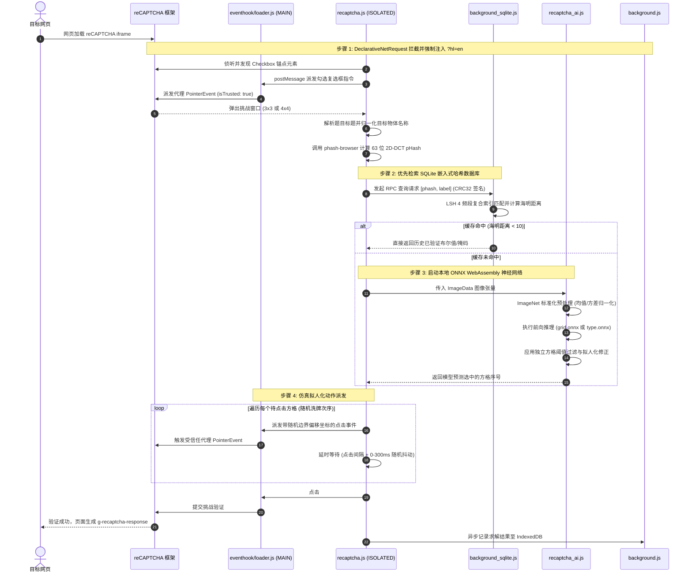

<p align="center">
  
</p>

<h1 align="center">MaiRec</h1>

<p align="center">
  <b>适用于 Chromium 浏览器的端侧高性能 reCAPTCHA v2 自动化求解器与分布式远程工作节点</b>
</p>

<p align="center">
  <a href="README.md">English</a> | <b>简体中文</b> | <a href="README_ja.md">日本語</a>
</p>

<p align="center">
  <a href="#核心特性"></a>
  <a href="#核心特性"></a>
  <a href="#核心特性"></a>
  <a href="#技术架构与实现原理"></a>
  <a href="#技术架构与实现原理"></a>
  <a href="LICENSE"></a>
  <a href="#隐私与数据遥测披露"></a>
</p>

---

## 目录

- [项目概述](#项目概述)
- [核心特性](#核心特性)
- [技术架构与实现原理](#技术架构与实现原理)
  - [系统拓扑架构](#系统拓扑架构)
  - [求解链路与时序流程](#求解链路与时序流程)
  - [核心组件深度解析](#核心组件深度解析)
- [项目目录结构](#项目目录结构)
- [运行环境与权限说明](#运行环境与权限说明)
- [安装与部署指南](#安装与部署指南)
  - [标准扩展安装（本地自动化）](#标准扩展安装本地自动化)
  - [远程工作节点安装（WS 插件模式）](#远程工作节点安装ws-插件模式)
- [配置与参数调节](#配置与参数调节)
- [远程控制模式 (WS Addon)](#远程控制模式-ws-addon)
- [常见问题与故障排查](#常见问题与故障排查)
- [隐私与数据遥测披露](#隐私与数据遥测披露)
- [代码贡献与二次开发](#代码贡献与二次开发)
- [开源协议与免责声明](#开源协议与免责声明)

---

## 项目概述

**MaiRec** 是一款基于 Google Chrome **Manifest V3 (MV3)** 扩展规范构建的高级浏览器扩展，旨在**完全在客户端本地**自动识别并求解 Google reCAPTCHA v2 人机验证挑战。通过在扩展安装包内集成深度卷积神经网络（ONNX 格式）与嵌入式感知哈希（pHash）数据库，MaiRec 无需调用任何付费第三方打码平台 API（如 2Captcha、Anti-Captcha 等），即可在用户端本地完成毫秒级的图像特征匹配与神经网络视觉推理。

无论您是在进行网页爬虫、渗透测试、自动化回归测试，还是在日常浏览中免受频繁弹窗打扰，MaiRec 都能提供零成本、低延迟且注重隐私的自动化验证解决方案。此外，MaiRec 还内置了基于 **Chrome DevTools Protocol (CDP)** 的 **WebSocket (WS) 远程控制打码层**，允许任何浏览器实例作为分布式节点接入自动化流水线中，实现全自动集群打码。

---

## 核心特性

- **100% 客户端本地神经网络推理**：
  - 基于 **ONNX Runtime Web**（WebAssembly 后端，支持多线程与 SIMD 指令集加速），直接在浏览器沙箱内完成前向推理。
  - 支持 3×3 独立切片物体分类与 4×4 大图网格目标定位的高精度识别。
- **pHash 感知哈希双轨加速缓存**：
  - 内置紧凑型 SQLite 数据库（`db/captcha.sqlite`），预置 **33,950+ 条已验证图像哈希**。
  - 采用 63-bit 2D-DCT 算法计算图像感知哈希，结合多索引分带局部敏感哈希（Multi-Index Band LSH）与海明距离检索（阈值 $< 10$）。
  - 缓存命中时可在数毫秒内直接返回历史答案，无需调用神经网络，大幅降低 CPU 开销。
- **全面覆盖 reCAPTCHA v2 挑战题型**：
  - 自动定位并勾选“我不是机器人”复选框（Checkbox）。
  - 支持 3×3 静态九宫格与动态淡入淡出（Dynamic Fading Tiles）挑战。
  - 支持 4×4 网格场景边界分割挑战（如交通信号灯、人行横道、桥梁、摩托车等）。
- **反爬规避与拟人化交互仿真**：
  - 在页面原生上下文（MAIN World）注入代理加载器，Hook 全局 `Element.prototype.addEventListener`，生成包装有 `isTrusted: true` 的真实 `PointerEvent`。
  - 采用 Fisher–Yates 洗牌算法随机打乱方格点击次序，避免机械式点击特征。
  - 在元素边界矩形范围内注入随机坐标偏移，并引入 0–300 ms 的动态非确定性时间抖动（Jitter）。
- **动态网络语言重定向 (DNR)**：
  - 利用 Chrome `declarativeNetRequest` 动态规则，自动为 reCAPTCHA 子框架请求注入 `hl=en` 语言参数。
  - 将多语言挑战题目统一规范为标准英文标签字典，避免因语言差异造成语义识别失败。
- **分布式远程打码工作节点 (WS Addon)**：
  - 可将任意 Chrome 浏览器转变为无头/自动化打码 Worker 节点。
  - 利用 Chrome 离屏文档（Offscreen Document）维持稳定的 WebSocket 长连接保活。
  - 通过 CDP 1.3 的 `Fetch` 协议域实施网络请求拦截，动态注入轻量级打码模板，回传求解 Token。
- **多语言用户界面支持**：
  - 弹窗设置界面原生支持 3 种语言本地化：简体中文、日语和英语，支持实时热切换与本地配置持久化保存。

---

## 技术架构与实现原理

### 系统拓扑架构

MaiRec 采用分层解耦、遵循 Chrome MV3 安全规范的混合运行架构：

```mermaid
flowchart TD
    subgraph BrowserContext["Chromium 浏览器运行时 (MV3)"]
        subgraph MainWorld["MAIN 世界 (页面原生上下文)"]
            Hook["eventhook/loader.js<br/>• 拦截 addEventListener<br/>• 代理伪造 isTrusted: true 指针事件"]
            FrameWatch["ws/recaptcha_frame_watch.js<br/>• 监控 reCAPTCHA 异常与 Token 生成"]
        end

        subgraph IsolatedWorld["ISOLATED 世界 (扩展内容脚本)"]
            RC["captcha/recaptcha.js<br/>• DOM 状态机与挑战调度中枢<br/>• 图像切片与点击动作派发"]
            AI["captcha/recaptcha_ai.js<br/>• ONNX Runtime Web WASM 推理引擎<br/>• 张量归一化与动态阈值过滤"]
            PHash["captcha/phash-browser.js<br/>• 2D-DCT 图像感知哈希计算模块"]
        end

        subgraph ServiceWorker["Background Service Worker (后台进程)"]
            BG["background.js<br/>• 调度中枢 / DNR 语言强制重定向<br/>• 带盐 CRC32 跨进程消息防伪验签"]
            SQL["background_sqlite.js<br/>• sql.js WebAssembly 数据库服务<br/>• 4-Band LSH 多索引海明距离检索"]
            Uploader["uploader.js<br/>• 样本打包器 (NDJSON 流式上传)"]
            WS_BG["ws/background_ws.js<br/>• CDP 会话中控<br/>• 请求拦截与极简模板注入"]
        end

        subgraph Offscreen["Offscreen 离屏文档"]
            WS_Client["ws/offscreen.js<br/>• 持久化 WebSocket 客户端<br/>• 事件循环漂移与健康度监控"]
        end

        subgraph Storage["沙箱与本地存储"]
            SQLiteFile[("db/captcha.sqlite<br/>(33,950+ 已验证哈希记录)")]
            IDB[("IndexedDB: caplog<br/>(求解日志与切片暂存)")]
            SyncStorage[("chrome.storage.local<br/>(用户偏好设置)")]
        end
    end

    subgraph RemoteEndpoints["远端服务端点 (可选)"]
        WSServer["远程 WebSocket 服务端<br/>(分布式打码任务分发中控)"]
        GoogleServers["*.google.com/recaptcha/*<br/>(Google 验证码官方服务)"]
    end

    %% 交互连线
    RC <-->|window.postMessage| Hook
    RC -->|动态 import| AI
    RC -->|动态 import| PHash
    RC <-->|chrome.runtime.sendMessage<br/>(CRC32 加盐验签)| BG
    BG --> SQL
    SQL --> SQLiteFile
    BG --> IDB
    BG --> SyncStorage
    WS_Client <-->|内部 RPC 通信| WS_BG
    WS_Client <-->|WSS 连接| WSServer
    WS_BG <-->|CDP 1.3 Debugger| MainWorld
    MainWorld <--> GoogleServers
```

### 求解链路与时序流程

自动化验证码求解遵循高效的“优先查表缓存、未命中回退神经网络”双轨执行链路：



### 核心组件深度解析

#### 1. 深度学习神经网络模型 (`extension/models/`)
- **`grid.onnx` (~26 MB)**：
  - 模型架构：基于 **EfficientNet-B1** 卷积神经网络构建，专用于 4×4 整张大图的多标签网格边界分割与分类（如红绿灯、人行横道、桥梁等）。
  - 输入张量：$240 \times 240 \times 3$ RGB 图像，经过 ImageNet 标准差与均值归一化（$\mu = [0.485, 0.456, 0.406]$, $\sigma = [0.229, 0.224, 0.225]$）。
  - 动态阈值机制：依赖 [`grid.meta.json`](extension/models/grid.meta.json) 为 16 个网格位置分别配置独立的置信度阈值，以修正透视畸变带来的判定偏差。
- **`motorcycles_b1.onnx` (~25 MB)**：
  - 针对高混淆度摩托车网格场景专项微调的 EfficientNet-B1 模型。
- **`type.onnx` (~25 MB)**：
  - 针对 3×3 独立 $100 \times 100$ 切片图像的多类别物体分类器，覆盖自行车、公共汽车、轿车、消防栓、楼梯、烟囱等 16 种核心目标类别。
- **WASM 运行时优化与并发保护**：
  - 加载 SIMD 与多线程支持的二进制模块 `ort-wasm-simd-threaded.jsep.wasm`。
  - 通过 `WeakMap` 与互斥 Promise 链实现推理互斥锁（`runSafe`），彻底规避多线程并发调用导致的 WebAssembly 内存冲突。

#### 2. 感知哈希与 SQLite 缓存引擎 (`phash-browser.js` & `background_sqlite.js`)
- **感知哈希计算**：
  1. 利用 `OffscreenCanvas` 将图像或切片强制下采样至 $32 \times 32$ 灰度矩阵。
  2. 采用预构建的 32 阶余弦变换表执行快速二维离散余弦变换（2D-DCT）。
  3. 截取左上角 $8 \times 8$ 低频系数（剔除代表直流总能量的 $(0,0)$ 分量，保留 63 个交流系数）。
  4. 计算 63 个系数的中位数，大于中位数置 `1`，否则置 `0`，生成 63 位二进制哈希。
- **高效数据库检索**：
  - 嵌入式只读数据库 `db/captcha.sqlite`（约 6.5 MB）包含 33,950+ 条已知记录。
  - 64 位哈希在数据库内部被拆解为 4 个 16-bit 频段虚拟列（`band0` 至 `band3`），并建立了 6 组两两组合的复合索引。
  - 查询命中后，在 JS 运行时通过 Brian Kernighan 位统计法计算精确海明距离，距离严格小于 10 时确认为同一张图片。

#### 3. 指针事件伪造与反反爬穿透 (`extension/eventhook/loader.js`)
- 传统的 JavaScript 原生事件派发（如 `element.click()`）会携带只读属性 `isTrusted: false`，会被 Google reCAPTCHA 严格风控机制拦截识别。
- MaiRec 在 `document_start` 时机将 `loader.js` 注入至页面 **MAIN 上下文**。
- 使用 ES6 `Proxy` 拦截全局 `Element.prototype.addEventListener`，静默捕获并缓存所有内部监听回调。
- 派发交互时，在底层构造真实的 `PointerEvent`，利用 Proxy 拦截 `isTrusted` 属性访问并强行返回 `true`，绕过客户端受信任事件校验。

#### 4. 安全跨上下文通信协议
- 内容脚本与后台 Service Worker 间的消息传递采用带盐 CRC32 防伪校验协议（预共享私有盐值 `"b5b38eb8f40354127a85285f82a51f8b"` + 微秒级随机 Nonce），杜绝恶意网页脚本伪造扩展内部 RPC 指令。

---

## 项目目录结构

```text
MaiRec/
├── .gitignore                      # Git 忽略配置（包含环境文件、IDE 与构建缓存）
├── LICENSE                         # MIT 开源许可证
├── README.md                       # 英文核心文档
├── README_zh-CN.md                 # 简体中文文档
├── README_ja.md                    # 日语文档
├── MaiRec.png                      # 项目高清图标与横幅 (512x512)
├── extension/                      # 主 Chrome MV3 扩展目录
│   ├── manifest.json               # 扩展清单配置（权限、内容脚本与 DNR 规则声明）
│   ├── background.js               # Service Worker 后台调度核心
│   ├── background_sqlite.js        # SQLite WebAssembly 数据库检索服务
│   ├── eventhook.js                # 内容脚本通信桩
│   ├── uploader.js                 # 样本采集与 NDJSON 分批上报模块
│   ├── popup.html                  # 扩展弹窗设置界面
│   ├── popup.js                    # 弹窗交互与状态绑定逻辑
│   ├── popup.css                   # 弹窗暗黑样式表
│   ├── i18n.js                     # 国际化语言管理器与多语言翻译包
│   ├── reports.html                # 独立上报/API Key 配置页面
│   ├── reports.js                  # 独立上报页面逻辑
│   ├── _locales/                   # 多语言国际化资源包（en, ja, zh）
│   │   ├── en/messages.json        # 英语语言包
│   │   ├── ja/messages.json        # 日语语言包
│   │   └── zh/messages.json        # 简体中文语言包
│   ├── captcha/                    # 核心人机验证识别算法库
│   │   ├── recaptcha.js            # 挑战解析、DOM 监听与动作调度器
│   │   ├── recaptcha_ai.js         # ONNX Runtime 模型加载与张量推理
│   │   └── phash-browser.js        # 2D-DCT 感知哈希纯前端计算库
│   ├── db/
│   │   └── captcha.sqlite          # 内置 6.5MB SQLite 数据库（含 3.3 万条答案哈希）
│   ├── eventhook/
│   │   └── loader.js               # MAIN 世界注入脚本（Hook addEventListener 伪造 isTrusted）
│   ├── icon/                       # 扩展图标资源（16, 32, 48, 128 px）
│   ├── lib/                        # WebAssembly 与通用辅助库
│   │   ├── selector.js             # CSS 选择器逆向生成工具
│   │   ├── sql-wasm.js             # sql.js WASM 胶水代码
│   │   ├── sql-wasm.mjs            # sql.js ES 模块版本
│   │   ├── sql-wasm.wasm           # SQLite WebAssembly 二进制引擎 (645 KB)
│   │   └── sql-wasm-wrapper.js     # sql.js 模块导出包装器
│   ├── libs/
│   │   └── onnxruntime-web/        # ONNX Runtime 官方分发包
│   │       ├── ort.esm.js          # ONNX Runtime ES 模块接口
│   │       ├── ort-wasm-simd-threaded.jsep.mjs
│   │       └── ort-wasm-simd-threaded.jsep.wasm # ONNX WASM 引擎 (21 MB)
│   ├── models/                     # 深度学习神经网络权重文件
│   │   ├── grid.onnx               # 4×4 EfficientNet-B1 网格多标签分类模型 (26 MB)
│   │   ├── grid.meta.json          # 4×4 网格每格独立阈值配置
│   │   ├── motorcycles_b1.onnx     # 4×4 摩托车专用优化模型 (25 MB)
│   │   ├── motorcycles_b1.meta.json# 摩托车专用阈值配置
│   │   └── type.onnx               # 3×3 独立切片物体分类模型 (25 MB)
│   └── ws/                         # WebSocket 远程控制工作节点模块
│       ├── background_ws.js        # WS 模式中枢（CDP 调试器管理与请求拦截）
│       ├── offscreen.html          # 离屏文档载体
│       ├── offscreen.js            # 离屏 WebSocket 客户端与心跳监控
│       └── recaptcha_frame_watch.js# 内部框架异常与 Token 监控脚本
└── ws-addon/                       # 独立的 WS Addon 附加层覆盖包
    ├── README.md                   # WS 插件详细使用与 API 对接说明
    ├── manifest.json               # 附加层清单（增加 debugger 与 offscreen 权限）
    ├── icon/                       # 插件图标
    └── ws/                         # 附加层源码
```

---

## 运行环境与权限说明

### 环境要求
- **支持的浏览器**：Google Chrome、Microsoft Edge、Brave、Opera 或任何支持 **Manifest V3** 的 Chromium 内核浏览器。
  - 最低推荐版本：**Chrome 116+**（使用 `chrome.offscreen` 离屏长连接与 CDP 协议必须）。
  - 若仅使用单机本地基础求解功能，最低可兼容至 **Chrome 111+**。
- **硬件配置**：
  - 具备多核 CPU 并支持 WebAssembly SIMD 指令集（x86_64 或 ARM64 / Apple Silicon）。
  - 神经网络前向推理期间需要约 **150 MB – 300 MB** 的空闲浏览器内存。

### 清单权限解析

| 权限名称 | 运行上下文 | 实际用途与作用 |
|---|---|---|
| `alarms` | Background | 驱动定时数据同步与 WebSocket 心跳监控保活。 |
| `declarativeNetRequest` | Network | 在网络底层动态为 reCAPTCHA 子请求追加 `hl=en` 参数，无需声明读取网页敏感内容的权限。 |
| `idle` | System | 检测用户系统是否空闲，在空闲态执行数据同步，不挤占活跃浏览带宽。 |
| `storage` | Browser | 本地持久化保存用户配置、超时设定与黑名单域名。 |
| `tabs` | Tabs | 在 WS 远程工作模式下自动化创建、切换与关闭受控标签页。 |
| `debugger` | CDP 1.3 | 控制 Chrome 开发者工具协议，实现轻量级模板注入与外部无关请求拦截。 |
| `offscreen` | Window | 创建常驻离屏文档，维持 WebSocket 长连接，免疫 Service Worker 自动休眠。 |
| `host_permissions` | Web | 拦截 `*://*.google.com/recaptcha/*` 及 `*://*.recaptcha.net/recaptcha/*`（WS 模式下扩展至 `<all_urls>` 以接管打码任务）。 |

---

## 安装与部署指南

### 标准扩展安装（本地自动化）

1. 将本仓库克隆至本地：
   ```bash
   git clone https://github.com/Melony-mai/MaiRec.git
   cd MaiRec
   ```
2. 打开 Google Chrome 或基于 Chromium 的浏览器，在地址栏输入：
   ```text
   chrome://extensions
   ```
3. 在页面右上角开启 **开发者模式 (Developer mode)**。
4. 点击左上角出现的 **加载已解压的扩展程序 (Load unpacked)** 按钮。
5. 在弹出的文件选择器中，选中项目根目录下的 **`extension/`** 文件夹。
6. 安装完成后，**MaiRec** 扩展将出现在已安装列表中。
7. *(推荐)* 点击浏览器右上角扩展拼图图标，将 MaiRec 固定到工具栏以便随时调节设置。

> [!NOTE]
> **后台主动预热机制**：MaiRec 会在浏览器启动时自动在后台离屏文档中静默预加载 WebAssembly 运行时与 ONNX 神经网络模型。当您遇到首个验证码挑战时，模型已预热完毕，立即可在约 180 毫秒内极速推理。

---

### 远程工作节点安装（WS 插件模式）

若您希望将当前浏览器实例作为分布式打码集群的工作节点（Worker Node）：

1. 按照上述步骤完成 `extension/` 文件夹的加载（本仓库中的 `extension/` 已内建完整的 WS 与离屏控制组件）。
2. 点击扩展图标打开弹窗，进入 **Reports** 菜单。
3. 填入您的 32 位工作节点 API Key，并开启 **WS mode**。
4. 扩展将自动创建离屏文档并与打码调度中心建立受控连接。

---

## 配置与参数调节

点击浏览器工具栏中的 MaiRec 图标即可唤起设置面板：

<p align="center">
  
</p>

弹窗设置面板在结构上划分为两个主要区块：**求解器设置**与**超时设置 / 报告**，并提供二级子菜单用于微调拟人化延时与配置数据上报。

### 1. 求解器设置

| 配置选项 | 默认状态 | 详细说明 |
|---|---|---|
| **Language** | `English` | 手动切换扩展界面语言（支持 English、日本語、简体中文 3 种语言，重启浏览器后保持偏好）。 |
| **Solver enabled** | `开启` | 扩展总开关，关闭后停止所有自动化拦截与求解行为。 |
| **reCAPTCHA support** | `开启` | 是否启用对 Google reCAPTCHA 挑战的识别支持。 |
| **Auto-click buttons** | `开启` | 检测到复选框时是否自动模拟点击“我不是机器人”。 |
| **Solve image challenges** | `开启` | 弹出图像验证码时是否自动通过本地 ONNX 模型进行切片识别与点击提交。 |

### 2. 超时设置 / 报告

该区块整合了远程工作节点与上报、延时相关参数配置：

| 配置选项 / 控件 | 默认状态 | 详细说明 |
|---|---|---|
| **WS mode** | `关闭` | 是否接入 WebSocket 远程打码调度中心作为分布式打码节点。现已移至此区块与上报设置合并归类；需在“报告”中配置 32 位有效 API Key 即可激活开关。 |
| **超时设置 (Timeouts)** | 按钮 | 进入延时配置子页面，调节拟人化行为停顿。 |
| **报告 (Reports)** | 按钮 | 进入上报与密钥配置子页面，查看发送状态及录入 16/32 位 API Key。 |

### 拟人化延时与时间参数 (Timeouts 子菜单)

| 延时参数 | 默认数值 | 可调区间 | 说明 |
|---|---|---|---|
| **Between tile clicks** | `300 ms` | $0 - 5000\text{ ms}$ | 3×3 九宫格中依次点击相邻方格之间的停顿间隔。 |
| **Dynamic reveal → click** | `850 ms` | $0 - 5000\text{ ms}$ | 动态渐变图片刷新后到再次点击该格的等待时间（已折算图像识别耗时）。 |
| **Last click → verify** | `850 ms` | $0 - 5000\text{ ms}$ | 选完最后一个目标方块到点击“验证 (Verify)”按钮之间的安全停顿。 |

> [!TIP]
> 扩展会在每次触发延时操作时，自动追加 **0–300 ms** 的非确定性随机抖动（Jitter），且 3×3 挑战会随机打乱点击方格的次序，最大限度还原真人点击特征。

---

## 远程控制模式 (WS Addon)

在开启 **WS 插件模式** 后，MaiRec 将转变为高效率的受控打码工作节点：

1. **长连接保活机制**：通过离屏文档（`ws/offscreen.html`）与调度中心建立稳定 WebSocket 通信，绕过 MV3 后台 Service Worker 容易被系统自动挂起的限制。
2. **事件循环健康度监控**：实时追踪浏览器主线程的事件循环漂移（P50、P95、P99 延迟指标），将负载画像随心跳回传给调度中心，确保任务被派发至响应迅速的健康实例。
3. **CDP 深度接管与请求沙箱化**：
   - 收到打码任务（`{ url, sitekey }`）后，通过 `chrome.tabs.create` 创建受控空白标签页。
   - 挂载 `chrome.debugger` 并开启 `Fetch.enable` 网络劫持。
   - 将原页面 Document 替换为零开销的极简 HTML 模板，直接挂载 `grecaptcha.render()`。
   - 拦截并阻断页面其他一切不相干的图片、样式、第三方分析脚本，实现超低资源消耗。
   - 识别成功截获有效 `g-recaptcha-response` Token 后，经由 WebSocket 即刻回传，受控标签页随后自动关闭。

该协议完全兼容标准 2Captcha 与 AntiCaptcha 自动化调用规范。

---

## 常见问题与故障排查

#### 1. 如何消除首次遇到验证码时的冷启动延迟？
在早期版本中，WebAssembly SIMD 引擎与 ONNX 模型是在首次遇到验证码时才临时加载与编译的，这导致了初始延迟。MaiRec 现已内建持久离屏后台预热引擎：在浏览器启动后，扩展会立即在后台预加载所有神经网络（`type.onnx`、`grid.onnx`、`motorcycles_b1.onnx`）并通过虚拟推断完成内核预热，且完全不占用或拖慢浏览器启动流程。首个验证码立即可享毫秒级响应（~180 ms）。

#### 2. 为什么 Chrome 顶部会弹出“MaiRec 正在调试此浏览器”的黄色提示栏？
该提示栏是 Google Chrome 内核在调用 `chrome.debugger` API 时强制显示的安全提示。它仅会在您主动开启 **WS 远程打码模式** 时出现。在常规单机本地浏览模式下不会触发此提示。

#### 3. 如果目标网站显示非英语的人机验证挑战怎么办？
MaiRec 内置了 `declarativeNetRequest` 网络规则，会自动在验证码框架加载时追加 `hl=en` 参数。请确保未禁用此扩展权限，并排查是否有其他 URL 重定向插件干扰了该参数。

#### 4. MaiRec 可以在完全断网的环境下运行吗？
可以。神经网络模型与 SQLite 哈希缓存均已打包在本地扩展内部。但请注意，加载 Google 验证码挑战本身仍然需要您的浏览器能够与 Google 验证码服务器正常通信。

---

## 隐私与数据安全披露

MaiRec 尊重用户隐私并保持高度透明：

- **纯本地推理**：所有验证码图像切分、感知哈希检索与神经网络推理均 100% 在您的本地设备 CPU 上运行。**绝不会为了求解验证码而将图片传输至任何外部服务器。**
- **隐私保护强化**：
  - 为保障用户隐私与数据安全，远端遥测数据上传已完全禁用，杜绝任何云端数据泄露隐患。
  - 扩展绝不会采集任何个人身份信息（PII）、浏览历史记录、Cookies 或账号密码。
  - 本地哈希数据库与 AI 运行环境完全限定在浏览器沙箱内运行。

---

## 代码贡献与二次开发

欢迎提交 Issue、功能建议与代码 Pull Request！

1. Fork 本仓库到您的 GitHub 账户。
2. 创建独立的特性分支：
   ```bash
   git checkout -b feature/model-optimization
   ```
3. 提交代码并附带规范清晰的 Commit 描述：
   ```bash
   git commit -m "feat(ai): optimize thresholding heuristics for crosswalks"
   ```
4. 推送分支至远端：
   ```bash
   git push origin feature/model-optimization
   ```
5. 提交 Pull Request 并详细说明变更内容。

---

## 开源协议与免责声明

### 开源协议
本项目采用 [MIT 许可证](LICENSE) 开源发布。

### 免责声明
本项目仅供计算机视觉算法研究、安全审计与无障碍辅助浏览研究之用。使用者应自行确保使用场景符合相关网站服务条款（ToS）及所在国家/地区法律法规。开发者对因不当使用本软件导致的任何直接或间接后果不承担任何法律责任。
