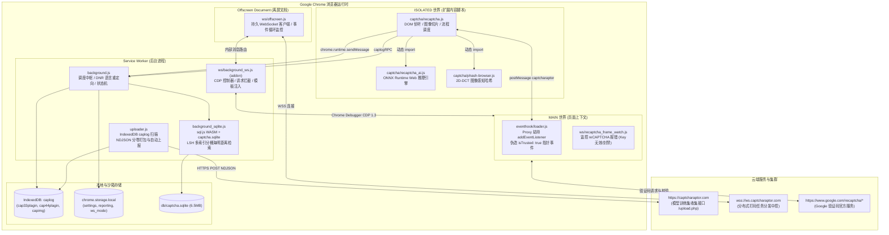
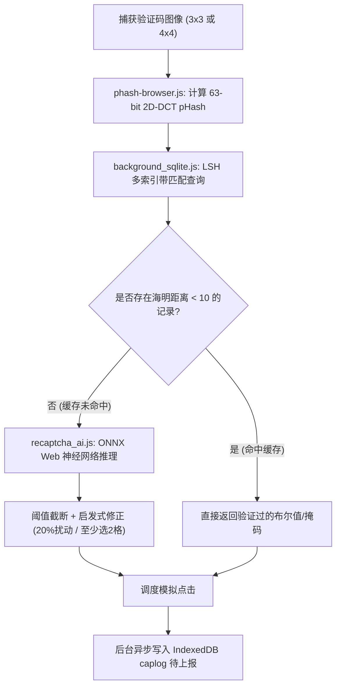
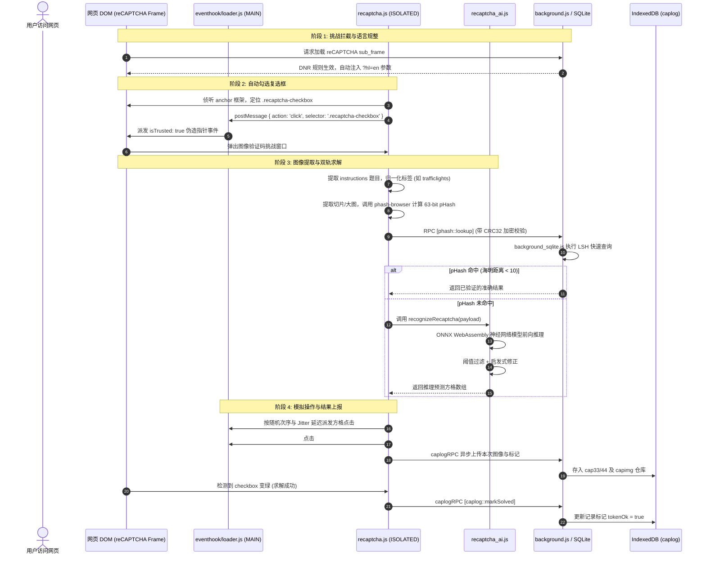
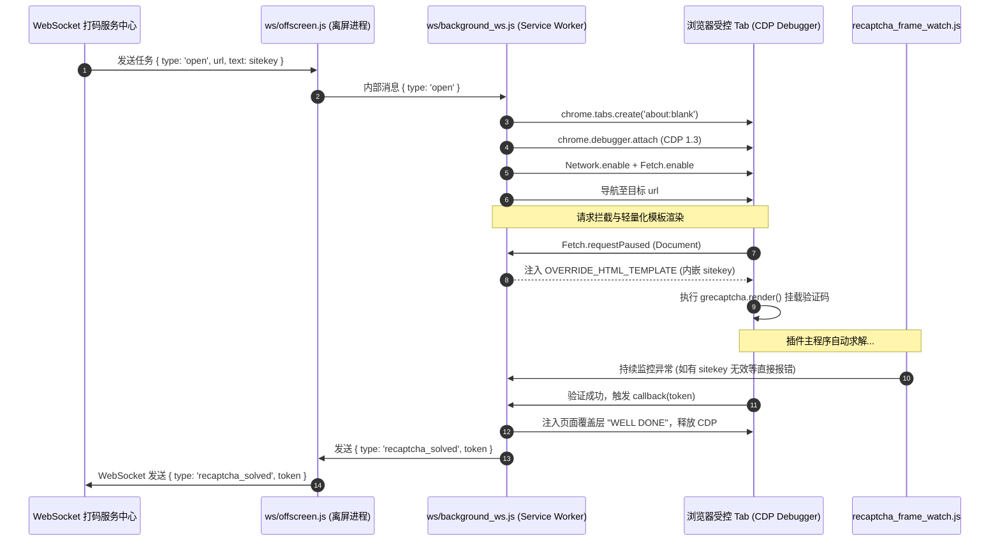

# Free AI ReCaptcha Solver by Raptor 项目源代码全面分析报告

---

## 1. 项目概述

### 1.1 项目背景与核心定位
本项目名为 **Free AI ReCaptcha Solver by Raptor**（又名 **Captcha Plugin**），是一套基于 Google Chrome 浏览器扩展规范（Manifest V3）构建的自动化 reCAPTCHA 识别与求解系统。

该系统最大的技术特色在于**完全基于客户端本地推理（On-Device Inference）**：它不依赖打码平台第三方付费 API（如 2Captcha、Anti-Captcha 等），而是将计算机视觉神经网络（ONNX 格式）与预编译的感知哈希数据库（SQLite WebAssembly）直接打包在浏览器扩展内部。当用户或自动化脚本在网页中遇到 Google reCAPTCHA v2（包含标准复选框、3×3 静态/动态九宫格、4×4 网格以及 Enterprise 版本）时，扩展能够全自动完成人机验证框点击、图像切片、本地特征匹配或神经网络推理、模拟真人点击动作并最终完成验证。

### 1.2 核心业务功能与使用场景
1. **常规浏览器自动化求解（扩展主程序 `extension/`）**：
   - 面向普通网民与渗透测试/数据抓取人员，在浏览包含 Google reCAPTCHA 的页面时自动识别验证码，自动勾选“I'm not a robot”，自动识别道路标志、红绿灯、汽车、公交车、消防栓等挑战图像并完成提交。
2. **分布式远程打码服务节点（扩展插件 `ws-addon/`）**：
   - 将安装了扩展的浏览器实例转变为自托管的打码工作节点（Worker Node）。通过持久 WebSocket 长连接与服务端（`wss://ws.captcharaptor.com`）通信，接收标准打码任务，利用 Chrome DevTools Protocol（CDP）在受控标签页中实时注入网页、拦截网络响应、解决验证码并回传有效凭据 Token。
3. **闭环训练数据采集系统（Telemetry & Dataset Collector）**：
   - 扩展在求解验证码的同时，会将遇到的图像、切片、感知哈希值及最终验证通过状态存储在浏览器本地 IndexedDB 中，并在后台空闲时以分块 NDJSON 格式自动上报至 `https://captcharaptor.com`，为后续模型迭代提供海量带标签的训练样本。

---

## 2. 技术栈与开发环境

### 2.1 运行时与浏览器环境
- **规范标准**：Google Chrome 扩展规范 **Manifest V3 (MV3)**
- **内核版本要求**：
  - 基础扩展（[`extension/manifest.json`](file:///home/mai/ProjectsM/captchaplugin-main/extension/manifest.json#L81)）：最低要求 **Chrome 111+**（需支持 MV3 Service Worker、OffscreenCanvas、WASM SIMD）。
  - WS 插件模式（[`ws-addon/manifest.json`](file:///home/mai/ProjectsM/captchaplugin-main/ws-addon/manifest.json#L74)）：最低要求 **Chrome 116+**（需使用 `chrome.offscreen` 持久文档保持 WebSocket 连接，以及 `chrome.debugger` CDP 1.3 协议）。
- **脚本执行环境**：
  - MV3 Background Service Worker（无 DOM、通过 Web Worker 规范执行）
  - Chrome Offscreen Document（支持 DOM 和持久 WebSocket 的离屏文档）
  - Content Script 隔离环境（ISOLATED World）与页面原生执行环境（MAIN World）

### 2.2 核心编程语言与框架
- **开发语言**：现代 JavaScript（ES2020+，使用 BigInt、ES Modules、Top-level await/Dynamic import、WeakMap、Proxy、CSSOM 等现代特性）。
- **深度学习推理引擎**：
  - **ONNX Runtime Web**（[`ort.esm.js`](file:///home/mai/ProjectsM/captchaplugin-main/extension/libs/onnxruntime-web/ort.esm.js)），执行后端为 `wasm`，加载了带有 SIMD 与多线程支持的 WebAssembly 引擎二进制文件 [`ort-wasm-simd-threaded.jsep.wasm`](file:///home/mai/ProjectsM/captchaplugin-main/extension/libs/onnxruntime-web/ort-wasm-simd-threaded.jsep.wasm)（体积约 21MB）。
  - 图优化配置：`graphOptimizationLevel: 'all'`。
- **神经网络架构**：
  - **4×4 网格多标签分类模型**：基于 **EfficientNet-B1** 骨干网络（[`grid.onnx`](file:///home/mai/ProjectsM/captchaplugin-main/extension/models/grid.onnx)，约 26MB，输入尺寸 240×240）。
  - **4×4 摩托车专用分类模型**：基于 **EfficientNet-B1** 骨干网络（[`motorcycles_b1.onnx`](file:///home/mai/ProjectsM/captchaplugin-main/extension/models/motorcycles_b1.onnx)，约 25MB，输入尺寸 240×240）。
  - **3×3 独立切片物体分类模型**：多类别分类器（[`type.onnx`](file:///home/mai/ProjectsM/captchaplugin-main/extension/models/type.onnx)，约 25MB，输入尺寸 100×100）。
- **数据库与本地存储**：
  - **sql.js (SQLite WebAssembly)**：[`sql-wasm.js`](file:///home/mai/ProjectsM/captchaplugin-main/extension/lib/sql-wasm.js) + [`sql-wasm.wasm`](file:///home/mai/ProjectsM/captchaplugin-main/extension/lib/sql-wasm.wasm)（约 645KB）。
  - **嵌入式 SQLite 数据库**：[`db/captcha.sqlite`](file:///home/mai/ProjectsM/captchaplugin-main/extension/db/captcha.sqlite)（约 6.5MB），内置 33,950 条已验证的感知哈希记录。
  - **客户端存储**：Chrome `storage.local`（配置管理与状态持久化）、IndexedDB（`caplog` 数据库用于暂存样本切片与求解历史）。
- **图像处理与算法库**：
  - 纯 JS 实现的二维离散余弦变换（2D-DCT）感知哈希算法 [`phash-browser.js`](file:///home/mai/ProjectsM/captchaplugin-main/extension/captcha/phash-browser.js)。
  - CSS 选择器生成库 [`selector.js`](file:///home/mai/ProjectsM/captchaplugin-main/extension/lib/selector.js)（基于 css-selector-generator）。
  - 多索引分桶（Multi-Index Hashing / LSH）海明距离快速检索。
- **协议与调试接口**：
  - Chrome DevTools Protocol (CDP 1.3)：`Network`、`Fetch` 协议域。
  - W3C WebSocket 协议（`wss://` 双向通信）。

---

## 3. 项目目录结构与关键文件说明

### 3.1 目录结构全貌

```text
captchaplugin-main/
├── LICENSE                         # MIT 开源许可证
├── README.md                        # 基础扩展说明文档
├── .gitignore                       # Git 忽略配置（包含混淆构建中间产物 .tmp_obf/）
├── extension/                       # 基础 Chrome 扩展根目录
│   ├── manifest.json                # 扩展清单配置文件（MV3，v0.2.3600）
│   ├── background.js                # 后台 Service Worker 核心脚本（调度、RPC、DNR、日志）
│   ├── background_sqlite.js         # SQLite WebAssembly 数据库管理器与 pHash 查询服务
│   ├── eventhook.js                 # 内容脚本通信桩代码
│   ├── uploader.js                  # 训练样本与求解日志自动化分批上报模块
│   ├── popup.html                   # 扩展弹窗设置界面 HTML
│   ├── popup.js                     # 扩展弹窗交互逻辑（设置读取/保存、WS 状态绑定）
│   ├── popup.css                    # 弹窗样式表（暗黑现代风格）
│   ├── reports.html                 # 独立的数据上报配置页面 HTML
│   ├── reports.js                   # 独立的数据上报交互逻辑
│   ├── _locales/                    # 多语言国际化资源包（11国语言）
│   │   ├── en/messages.json         # 英文语言包（核心说明文档）
│   │   ├── zh/messages.json         # 简体中文语言包
│   │   └── ...                      # ar, de, es, fr, id, ja, ms, pt, ru
│   ├── captcha/                     # 验证码识别与求解核心逻辑
│   │   ├── phash-browser.js         # 基于 Canvas 和 2D-DCT 的感知哈希计算模块
│   │   ├── recaptcha.js             # reCAPTCHA DOM 监控、切片、求解调度与动作模拟主程序
│   │   └── recaptcha_ai.js          # ONNX Runtime 模型加载、张量预处理与推理逻辑
│   ├── db/
│   │   └── captcha.sqlite           # 包含 3.3 万条已知图像哈希答案的只读缓存数据库
│   ├── eventhook/
│   │   └── loader.js                # MAIN 世界注入脚本（劫持 addEventListener，伪造 isTrusted）
│   ├── icon/                        # 扩展图标文件（16px, 32px, 48px, 128px 正常/禁用态）
│   ├── lib/
│   │   ├── selector.js              # CSS 选择器生成工具库
│   │   ├── sql-wasm.js              # sql.js 胶水代码
│   │   ├── sql-wasm.mjs             # sql.js ES 模块版本
│   │   ├── sql-wasm.wasm            # SQLite 引擎 WebAssembly 二进制
│   │   └── sql-wasm-wrapper.js      # sql.js 模块导出包装器
│   ├── libs/
│   │   └── onnxruntime-web/         # ONNX Runtime Web 运行时库
│   │       ├── ort.esm.js           # ONNX Runtime ES 模块接口
│   │       ├── ort-wasm-simd-threaded.jsep.mjs  # WASM 加载与 Worker 胶水代码
│   │       └── ort-wasm-simd-threaded.jsep.wasm # ONNX Runtime WebAssembly 核心二进制
│   ├── models/                      # 神经网络模型及元数据文件
│   │   ├── grid.onnx                # 4×4 多类别网格分类模型（26MB）
│   │   ├── grid.meta.json           # 4×4 模型类别映射与每格动态置信度阈值配置
│   │   ├── motorcycles_b1.onnx      # 4×4 摩托车专用优化模型（25MB）
│   │   ├── motorcycles_b1.meta.json # 摩托车专用模型每格阈值配置
│   │   └── type.onnx                # 3×3 独立切片物体分类模型（25MB）
│   └── ws/
│       └── background_ws.js         # 基础版中的 WS 桩代码（声明 WS_MODE_AVAILABLE = false）
└── ws-addon/                        # WS 远程控制附加层（覆盖安装在 extension/ 之上）
    ├── README.md                    # WS 插件详细使用与 API 对接文档
    ├── manifest.json                # 升级版清单文件（增加 debugger, offscreen 等高级权限）
    └── ws/
        ├── background_ws.js         # WS 模式后台中枢（CDP 拦截、受控标签页管理、Token 监听）
        ├── offscreen.html           # 离屏文档容器 HTML
        ├── offscreen.js             # 离屏 WebSocket 客户端（事件循环监控、看门狗、断线重连）
        └── recaptcha_frame_watch.js # reCAPTCHA 内部 iframe 异常状态实时监测脚本
```

### 3.2 关键文件职能对照表

| 文件路径 | 执行上下文 | 核心职能 |
|---|---|---|
| [`extension/manifest.json`](file:///home/mai/ProjectsM/captchaplugin-main/extension/manifest.json) | 配置元数据 | 声明 MV3 权限、Content Scripts 注入规则、Web 资源可访问性、CSP 安全策略 |
| [`extension/background.js`](file:///home/mai/ProjectsM/captchaplugin-main/extension/background.js) | Service Worker | 后台服务中枢：初始化 DNR 强制英文规则、路由内部 RPC、管理 IndexedDB 日志、标记已解出 Token |
| [`extension/background_sqlite.js`](file:///home/mai/ProjectsM/captchaplugin-main/extension/background_sqlite.js) | Service Worker | 加载 WebAssembly SQLite，执行 64-bit 感知哈希分桶匹配及海明距离检索 |
| [`extension/captcha/recaptcha.js`](file:///home/mai/ProjectsM/captchaplugin-main/extension/captcha/recaptcha.js) | Content Script (ISOLATED) | 核心业务流：监控勾选框与弹窗、切分图像、优先查表（pHash）、未命中转 AI、模拟点击、记录上报 |
| [`extension/captcha/recaptcha_ai.js`](file:///home/mai/ProjectsM/captchaplugin-main/extension/captcha/recaptcha_ai.js) | Content Script (Dynamic) | 神经网络运行时：加载 ONNX 模型、RGB 归一化为 Tensor、并发安全推理锁、输出阈值过滤与启发式修正 |
| [`extension/captcha/phash-browser.js`](file:///home/mai/ProjectsM/captchaplugin-main/extension/captcha/phash-browser.js) | Content Script / SW | 感知哈希算法：灰度加权、OffscreenCanvas 缩放、32×32 2D-DCT 变换、63 位二值化输出 |
| [`extension/eventhook/loader.js`](file:///home/mai/ProjectsM/captchaplugin-main/extension/eventhook/loader.js) | Content Script (MAIN) | 反爬穿透：Hook `Element.prototype.addEventListener`，使用 Proxy 构造 `isTrusted=true` 的合成指针事件 |
| [`extension/uploader.js`](file:///home/mai/ProjectsM/captchaplugin-main/extension/uploader.js) | Service Worker | 遥测与数据集上报：扫描本地 IndexedDB，打包为 NDJSON，通过带鉴权的 HTTP POST 上报并自动清空已传数据 |
| [`ws-addon/ws/background_ws.js`](file:///home/mai/ProjectsM/captchaplugin-main/ws-addon/ws/background_ws.js) | Service Worker | 远程控制后台：管理 CDP 调试会话、拦截 Fetch 请求、注入自定义 reCAPTCHA 渲染模板、捕获有效 Token |
| [`ws-addon/ws/offscreen.js`](file:///home/mai/ProjectsM/captchaplugin-main/ws-addon/ws/offscreen.js) | Offscreen Document | WebSocket 长连接客户端：维持心跳、统计事件循环延迟负载、任务超时看门狗 |
| [`ws-addon/ws/recaptcha_frame_watch.js`](file:///home/mai/ProjectsM/captchaplugin-main/ws-addon/ws/recaptcha_frame_watch.js) | Content Script (MAIN) | 异常侦测：注入到 reCAPTCHA 内部 iframe，监控“Site Key 无效”、“域名受限”、“IP 被封禁”等错误 |

---

## 4. 整体架构与模块关系

项目整体采用**分层解耦、混合模式（本地独立运行 + 可选集群受控）**的现代前端与浏览器扩展架构。各模块间通过 Chrome 扩展内部的通信机制（Message Passing / Ports / PostMessage）与 CDP 协议协同作业。

### 4.1 架构系统拓扑图



### 4.2 模块间通信与安全验证协议
为了防止其他外部脚本伪造指令，扩展在内容脚本与后台 Service Worker 之间设计了双向签名鉴权协议：
1. **CRC32 动态加盐校验**：
   在 [`recaptcha.js`](file:///home/mai/ProjectsM/captchaplugin-main/extension/captcha/recaptcha.js#L13-L28) 与 [`background.js`](file:///home/mai/ProjectsM/captchaplugin-main/extension/background.js#L228-L243) 中，双方预共享私有盐字符串 `"b5b38eb8f40354127a85285f82a51f8b"`。
   - 内容脚本发起请求时，生成随机 Nonce `n = "" + [+new Date, performance.now(), Math.random()]`，发送格式为 `[n, rpcOp, ...args]`。
   - Service Worker 处理完毕后，计算 `D(n) = CRC32("b5b38eb8f40354127a85285f82a51f8b" + n)` 作为应答包头 `[D(n), result]`。
   - 内容脚本仅在校验通过后才信任返回数据，防止消息被第三方伪造或污染。
2. **跨界通信（MAIN $\leftrightarrow$ ISOLATED）**：
   内容脚本与原生页面隔离，通过 `window.postMessage` 传递标记有 `{ source: "captcharaptor" }` 的事件指令，经由 `eventhook/loader.js` 转换为受信任的高级用户输入。

---

## 5. 核心功能及实现原理

### 5.1 强制英文语言重定向（DNR）
reCAPTCHA 挑战题目在不同国家语言下关键词不同（例如“红绿灯”在中文为“交通灯”，英文为“traffic lights”）。为了让模型和分类字典准确匹配，系统在后台利用 `declarativeNetRequest` 动态规则，强制劫持所有 sub_frame 级别的 reCAPTCHA 请求：
```javascript
// 代码位置: extension/background.js:6-33
i.declarativeNetRequest.updateDynamicRules({
    addRules: [{
        id: 1,
        priority: 1,
        action: {
            type: "redirect",
            redirect: {
                transform: {
                    queryTransform: {
                        addOrReplaceParams: [{ key: "hl", value: "en" }] // 强制语言为英文
                    }
                }
            }
        },
        condition: {
            regexFilter: "^https?:\\/\\/[^\\.]*\\.(google\\.com|recaptcha\\.net)\\/recaptcha",
            resourceTypes: ["sub_frame"]
        }
    }],
    removeRuleIds: [1]
});
```

### 5.2 挑战识别与标签解析（Label Parsing）
当 reCAPTCHA 图像弹窗出现时，扩展从 `.rc-imageselect-instructions` 容器提取标题文本：
- 函数 [`extractLabel`](file:///home/mai/ProjectsM/captchaplugin-main/extension/captcha/recaptcha.js#L121-L124) 使用正则 `/with\s+(?:an?\s+)?([a-z]+)/` 匹配目标名词（例如 `"Select all images with traffic lights"` $\rightarrow$ `"traffic lights"`）。
- 函数 [`normalizeLabel`](file:///home/mai/ProjectsM/captchaplugin-main/extension/captcha/recaptcha.js#L126-L130) 通过预置的 `ALIAS` 词典进行同义词归一化（如 `bike` $\rightarrow$ `bicycles`，`firehydrant` $\rightarrow$ `hydrants`，`pedestrian` $\rightarrow$ `crosswalks`），映射到系统预支持的 16 种核心类别集合中。

### 5.3 混合双轨求解机制：感知哈希（pHash）缓存 $\rightarrow$ 神经网络推理
为了同时保证极致的求解速度与泛化能力，系统构建了“先查表缓存，未命中则运行深度学习模型”的执行链路：



#### 5.3.1 离线感知哈希计算（`phash-browser.js`）
不同于传统的图片 MD5，系统自研了适用于浏览器的感知哈希算法：
1. **缩放与灰度加权**：利用 `OffscreenCanvas` 将传入的切片强制重采样为 32×32 像素，按公式 $Y = (299R + 587G + 114B) / 1000$ 提取亮度矩阵。
2. **二维离散余弦变换（2D-DCT）**：预计算 32 阶余弦变换表 `COS32`，对 32×32 矩阵执行快速两轮 1D-DCT 变换（行与列）。
3. **低频二值化编码**：截取左上角 8×8 的低频分量（排除代表直流总能量的 $(0,0)$ 分量，共 63 个交流系数）。计算其中位数 `med`，遍历 63 个系数，大于中位数置 `1`，否则置 `0`，生成 63 位 BigInt，格式化为 16 位十六进制字符串输出。

#### 5.3.2 局部敏感哈希（LSH）与海明距离检索（`background_sqlite.js`）
数据库 [`db/captcha.sqlite`](file:///home/mai/ProjectsM/captchaplugin-main/extension/db/captcha.sqlite) 包含两张表：
- `phash33`（23,883 条记录，对应 3×3 切片标签与选中状态 `selected`）
- `phash44`（10,067 条记录，对应 4×4 整张大图与 16 位十六进制掩码 `mask`）

在 SQLite 中，64 位哈希被预先拆分为 4 个 16-bit 频段存储（`band0` 到 `band3`），并建立了 6 组两两组合的复合索引（如 `idx33_band01` 至 `idx33_band23`）。
查询时，只要任意 2 个频段（即 32 位）完全一致即可命中候选集；随后在 JS 层通过 BigInt 异或与 Brian Kernighan 位统计法计算精确海明距离：
```javascript
// 代码位置: extension/background_sqlite.js:23-27
function hamming64(a, b) {                   
  let v = BigInt.asUintN(64, a ^ b), c = 0n;
  while (v) { v &= v - 1n; c++; }
  return Number(c);
}
// 判定阈值：海明距离 < 10 判定为同一张历史图片，直接返回历史答案
const hit = candidates.find(r => r.hamming < 10);
```

#### 5.3.3 ONNX Runtime 本地神经网络推理（`recaptcha_ai.js`）
当哈希未命中或部分切片未命中时，启动本地神经网络：
1. **图像切分与预处理**：
   - 3×3 挑战：将 300×300 图像切分为 9 个 100×100 的子 Canvas。
   - 4×4 挑战：将整张大图重采样至 240×240。
   - 像素归一化：将像素除以 255 后，应用 ImageNet 标准均值与标准差：
     $$\text{Mean} = [0.485, 0.456, 0.406], \quad \text{Std} = [0.229, 0.224, 0.225]$$
2. **并发安全锁（`runSafe`）**：
   通过 `WeakMap` 与 Promise 链为 ONNX Session 实例构建并发互斥锁，避免多线程 WASM 在并发推理时发生内存段冲突。
3. **输出阈值过滤**：
   从输出 Tensor 提取 Logits，经由 Sigmoid 激活函数映射为置信概率 $p \in [0, 1]$。
   - 3×3 挑战对照 [`THR.type`](file:///home/mai/ProjectsM/captchaplugin-main/extension/captcha/recaptcha_ai.js#L4-L24) 独立设定的类别阈值（如水上船只 `boats: 0.071`，消火栓 `hydrants: 0.111`，汽车 `cars: 0.928`）。
   - 4×4 挑战从 [`grid.meta.json`](file:///home/mai/ProjectsM/captchaplugin-main/extension/models/grid.meta.json#L35-L234) 中读取该类别的**每个网格位置独立阈值**（共 16 个位置阈值，针对不同视觉透视区域进行差异化判定）。
4. **针对 reCAPTCHA 规则的启发式修正**：
   - **20% 随机扰动机制**（代码标注 `// 20% — la vida es un carrusel`）：在 20% 的概率下引入概率抖动翻转，模拟人类的不确定性判断。
   - **最少选择 2 格约束**：reCAPTCHA 4×4 验证码通常要求至少选中两个方块。如果模型仅选中 1 个方块，代码会自动从剩余格子中找出未选中格里置信度最高的格子强制设为选中（[`recaptcha_ai.js:395-425`](file:///home/mai/ProjectsM/captchaplugin-main/extension/captcha/recaptcha_ai.js#L395-L425)）。
   - **3×3 挑战 3~4 格约束**（[`enforce3to4`](file:///home/mai/ProjectsM/captchaplugin-main/extension/captcha/recaptcha.js#L218-L238)）：强行将选中数量控制在 3 至 4 格之间（若不足 3 格随机补齐，若超过 4 格随机剔除）。

### 5.4 反反爬与真实用户事件伪造（`eventhook/loader.js`）
现代 reCAPTCHA 的客户端检测脚本会严密校验鼠标点击事件的 `isTrusted` 属性（原生用户点击为 `true`，普通 JS 的 `dispatchEvent` 为 `false`），并统计点击时间间隔与轨迹特征。
系统通过以下底层 Hook 技术绕过检测：
1. **MAIN 世界事件劫持**：
   在 `document_start` 时机将 [`eventhook/loader.js`](file:///home/mai/ProjectsM/captchaplugin-main/extension/eventhook/loader.js) 注入到页面的 MAIN 世界，通过 ES6 Proxy 代理全局 `Element.prototype.addEventListener`。所有页面元素绑定的监听器均被静默截获并缓存在 `WeakMap` 中。
2. **Proxy 伪造 `isTrusted: true`**：
   当收到点击指令时，创建真实的 `PointerEvent`，并用 Proxy 包裹该事件对象：
   ```javascript
   // 代码位置: extension/eventhook/loader.js:90-103
   function h(e, n, t, r) {
       let o = new window[e](n, t),
           a = {
               get(u, s, p) {
                   if (s === "isTrusted") return !0; // 强行返回 true
                   if (s in r) return r[s];
                   let c = o[s];
                   return c instanceof Function ? c.bind(o) : c
               }
           };
       return new Proxy(o, a)
   }
   ```
   然后从 `WeakMap` 中提取原始回调函数并直接触发，使 reCAPTCHA 内部监听器接收到合法的“受信任”事件。
3. **坐标合成与时间抖动**：
   - 动态计算目标元素 `getBoundingClientRect()`，在元素边界内生成随机偏移量坐标。
   - 每次点击引入随机 Jitter（`0 ~ 300ms` 动态随机延迟）。
   - 对 3×3 九宫格采用 **Fisher–Yates 洗牌算法**打乱方格点击次序，避免机械的从左到右、从上到下点击。

### 5.5 数据遥测与样本上报引擎（`uploader.js`）
扩展内建了一个完整的数据采集管线：
1. **数据捕获**：每当验证码求解时，将图像 Base64、计算出的 pHash、题目类别、步骤编号及本次任务唯一标识 `solvingid` 写入 IndexedDB 数据库 `caplog`（含 `cap33plagin`、`cap44plagin`、`capimg` 三张对象仓库）。
2. **最终成功状态对齐**：当外层复选框变绿或检测到 `recaptcha-checkbox-checked` 时，Service Worker 触发 `markSolved`，利用 `solvingid` 索引批量将对应的图像切片标记为 `tokenOk = true`（确认该组标记有效）。
3. **流式分块打包（NDJSON）**：[`uploader.js`](file:///home/mai/ProjectsM/captchaplugin-main/extension/uploader.js) 周期性检查超过 60 秒的陈旧记录，以 5MB / 10,000 行限制为单位打包为 `.ndjson` 文件。
4. **智能退避上报**：检查网络状态（优先 Wi-Fi / 以太网），向 `https://captcharaptor.com/upload.php` 发起分块上传；服务端返回 200 成功后，物理删除本地 IndexedDB 已传数据；遇到 413 自动减半数据包，遇到 5xx 启动指数退避重试。

### 5.6 远程控制打码模式（`ws-addon`）
`ws-addon` 模块将浏览器转变为类似无头浏览器的云打码机：
1. **持久连接保活**：由于 MV3 Service Worker 会在数十秒无活动后被浏览器休眠，插件在后台打开一个专用的离屏文档 [`ws/offscreen.html`](file:///home/mai/ProjectsM/captchaplugin-main/ws-addon/ws/offscreen.html)，在 [`offscreen.js`](file:///home/mai/ProjectsM/captchaplugin-main/ws-addon/ws/offscreen.js) 中维持与中控服务器的持久 WebSocket 连接（25 秒定时 Ping 心跳）。
2. **事件循环性能监控**：在离屏文档中通过定时器高频监测浏览器主线程漂移（Lag），统计 P50、P95、P99 延迟，构建负载画像并随心跳上报，协助中控服务器评估该节点的健康度与派单优先级。
3. **CDP 深度接管与请求沙箱化**：
   收到打码指令后，调用 `chrome.debugger.attach` 接管标签页，开启 `Fetch.enable`：
   - 将原页面 Document 请求完全拦截并替换为轻量级自定义模板 [`OVERRIDE_HTML_TEMPLATE`](file:///home/mai/ProjectsM/captchaplugin-main/ws-addon/ws/background_ws.js#L92-L141)。
   - 放行 Google reCAPTCHA 核心静态脚本及必要请求，将其他一切无关网络请求全部以空内容拦截阻断，实现极限加载速度与流量节省。
   - 显式调用 `window.grecaptcha.render` 挂载验证码，在回调中截获 `token`，通过 WebSocket 回传后，利用 `document.write` 替换页面内容为 `"WELL DONE"` 并自动回收标签页。

---

## 6. 程序执行流程与数据流

### 6.1 常规浏览器内求解时序流



### 6.2 远程 WS 打码模式时序流



### 6.3 数据结构与持久化模型

#### 1. SQLite 哈希缓存结构（`extension/db/captcha.sqlite`）
```sql
CREATE TABLE phash33 (
  id       INTEGER PRIMARY KEY,
  label    TEXT    NOT NULL,
  phash    INTEGER NOT NULL,
  band0    INTEGER GENERATED ALWAYS AS ((phash >> 48) & 0xFFFF) STORED,
  band1    INTEGER GENERATED ALWAYS AS ((phash >> 32) & 0xFFFF) STORED,
  band2    INTEGER GENERATED ALWAYS AS ((phash >> 16) & 0xFFFF) STORED,
  band3    INTEGER GENERATED ALWAYS AS ( phash        & 0xFFFF) STORED,
  selected INTEGER NOT NULL
);
-- 针对 4 频段的两两组合复合索引（共 6 个组合）实现快速剪枝
CREATE INDEX idx33_band01 ON phash33(band0, band1);
...
```

#### 2. IndexedDB 遥测数据结构（数据库名：`caplog`，版本：4）
- 对象仓库 **`cap33plagin`** / **`cap44plagin`**：
  `{ id (自增主键), solvingid, type, step, phash, selected, tokenOk, tokenTs, version, ts }`
- 对象仓库 **`capimg`**（容量上限 100,000 条，先进先出自动淘汰）：
  `{ id (自增主键), phash (唯一索引), img (JPEG Base64 编码), ts }`

---

## 7. 配置文件、依赖项及运行要求

### 7.1 清单文件配置与权限分析

#### 基础版清单（[`extension/manifest.json`](file:///home/mai/ProjectsM/captchaplugin-main/extension/manifest.json)）
- **清单版本**：Manifest V3
- **权限声明 (`permissions`)**：
  - `alarms`：用于定时驱动遥测数据上报心跳。
  - `declarativeNetRequest`：用于在网络底层强制追加 `hl=en` 语言参数，无需声明拦截敏感权限。
  - `idle`：检测系统是否处于空闲态（`idle` 或 `locked`），利用空闲带宽上报数据。
  - `storage`：读取与持久化扩展配置信息。
- **内容安全策略 (`content_security_policy`)**：
  ```json
  "extension_pages": "script-src 'self' 'wasm-unsafe-eval'; object-src 'self';"
  ```
  显式声明 `'wasm-unsafe-eval'`，这是 Chrome 扩展加载并编译执行 WebAssembly（ONNX Runtime 和 sql.js）所必须的合规权限。
- **主机权限 (`host_permissions`)**：
  `*://*.google.com/recaptcha/*`（仅匹配 Google 验证码核心子域）。
- **外部可访问资源 (`web_accessible_resources`)**：
  将所有模型文件、WASM 核心、SQLite 数据库暴露给 `<all_urls>`，使得注入在网页上下文的内容脚本可以通过 `chrome.runtime.getURL()` 动态拉取。

#### WS 增强版清单（[`ws-addon/manifest.json`](file:///home/mai/ProjectsM/captchaplugin-main/ws-addon/manifest.json)）
相较于基础版，增加了如下强力系统级权限：
- `tabs`：跨域创建、查询、更新与销毁受控标签页。
- `scripting`：动态向受控页面及所有子框架注入监控代码。
- `debugger`：控制 Chrome DevTools Protocol，进行底层网络劫持与 DOM 树覆写。
- `offscreen`：创建无 UI 的离屏文档，维系全生命周期的 WebSocket 连接。
- `host_permissions` 提升为 `<all_urls>`：确保能接管任意目标网站的打码请求。

### 7.2 外部依赖项分析

| 依赖库名称 | 版本/规范 | 文件体积 | 来源与用途 |
|---|---|---|---|
| **ONNX Runtime Web** | 1.x (SIMD-threaded) | ~22 MB | 官方预编译二进制，用于在浏览器内利用 WASM 运行 AI 模型 |
| **sql.js** | 1.x (WASM) | ~740 KB | SQLite 官方 WASM 移植版，用于在前端内存中快速执行 SQL 检索 |
| **css-selector-generator** | 3.x (Bundled) | ~8.7 KB | 第三方开源库，用于为 DOM 元素反向推导唯一的绝对 CSS 选择器 |
| **EfficientNet-B1 ONNX** | 自训练导出版 | ~76 MB | 专门针对 reCAPTCHA 训练的卷积神经网络权重文件 |

### 7.3 硬件资源与运行环境要求
- **CPU 性能**：AI 模型（`grid.onnx` 与 `type.onnx`）通过 CPU WebAssembly 多线程与 SIMD 运行，单次前向推理耗时约 300ms ~ 1500ms（取决于 CPU 核心数与架构）。首次启动因 WASM 编译及模型加载，可能存在 5~15 秒的初始化开销（官方在 `messages.json` 中亦有明确说明）。
- **内存占用**：扩展运行峰值内存约为 **150MB ~ 300MB**（SQLite 数据库一次性解压到 ArrayBuffer 占用约 6.5MB 堆内存；ONNX Runtime 模型与张量缓存占用约 100MB 内存）。

---

## 8. 安全性、稳定性与兼容性分析

### 8.1 安全机制与隐患评估

> [!CAUTION]
> **隐患 1：`eventhook/loader.js` 存在跨源消息伪造与 DOM 点击劫持漏洞**
> 在 [`loader.js:124-128`](file:///home/mai/ProjectsM/captchaplugin-main/extension/eventhook/loader.js#L124-L128) 中，监听 `window.addEventListener("message", ...)` 时**完全没有校验 `m.origin`**：
> ```javascript
> addEventListener("message", m => {
>     let d = m.data;
>     typeof d != "object" || d.source !== "captcharaptor" || (m.stopImmediatePropagation(), i(d))
> })
> ```
> 任何存在于 reCAPTCHA 框架内或父级页面的恶意第三方脚本，只需通过 `postMessage({ source: 'captcharaptor', action: 'click', selector: '任意CSS选择器' }, '*')`，即可诱使扩展在 MAIN 上下文中伪造 `isTrusted=true` 的点击事件。虽然代码中含有 `i.has(o)` 限制，但这依然可能被利用于未授权操作。

> [!WARNING]
> **隐患 2：硬编码认证凭证与对称秘钥**
> 1. 在 [`ws-addon/ws/offscreen.js:5`](file:///home/mai/ProjectsM/captchaplugin-main/ws-addon/ws/offscreen.js#L5) 中，直接明文硬编码了全局认证密钥：
>    ```javascript
>    const AUTH_TOKEN = 'CSGOSECRET1111!!WOWRAPTOR';
>    ```
>    所有连接到官方 WS 中控的客户端均共享同一固定 Token，易导致伪造节点接入。
> 2. CRC32 消息校验盐值 `"b5b38eb8f40354127a85285f82a51f8b"` 属于客户端公开字符串，仅能防范基础层面的偶发通信污染，不具备抗逆向攻击能力。

> [!WARNING]
> **隐患 3：用户隐私知情权与界面描述矛盾**
> 弹窗界面 [`popup.html:39`](file:///home/mai/ProjectsM/captchaplugin-main/extension/popup.html#L39) 明确告知用户：
> *`"Models run locally, no data is sent outside."`（模型在本地运行，没有任何数据发送到外部）*。
> 但实质上，扩展后台的 [`uploader.js`](file:///home/mai/ProjectsM/captchaplugin-main/extension/uploader.js) 模块会在后台静默将用户浏览过程中遇到的**完整验证码图像切片、题目、解题动作及访问上下文**自动打包并周期性上传至商业服务器 `captcharaptor.com`。此行为存在严重的合规性风险与用户知情权缺失问题。

### 8.2 稳定性与容错评估
1. **Service Worker 内存与生命周期隐患**：
   在 [`background_sqlite.js`](file:///home/mai/ProjectsM/captchaplugin-main/extension/background_sqlite.js#L13-L20) 中，每次 Service Worker 从休眠中唤醒时，都会重新触发 `fetch('db/captcha.sqlite')` 并将其读入内存实例化为 `new SQL.Database`。频繁唤醒可能导致浏览器出现瞬间的 CPU 飙升与 GC 压力。
2. **并发推理锁设计优良**：
   [`recaptcha_ai.js`](file:///home/mai/ProjectsM/captchaplugin-main/extension/captcha/recaptcha_ai.js#L45-L52) 中的 `runSafe` 函数利用 `WeakMap` 与互斥 Promise 链条对 Session 进行排队，有效避免了多切片或多 Tab 触发并发前向传播时导致底层 WebAssembly 内存崩溃。
3. **CDP 调试黄条与检测风险**：
   `ws-addon` 开启 `chrome.debugger` 时，Chrome 顶部会出现强制性的调试警告栏（*“Captcha Plugin 正在调试此浏览器”*），页面也可以通过特定性能时序检测到调试器的存在。

### 8.3 兼容性与国际化
- **语言强依赖**：模型严格绑定英文关键字。虽然扩展提供了 11 种语言的 UI，但验证码解析依赖于 DNR 强制插入 `hl=en`。若用户网络环境或反代策略阻断了该参数替换，扩展将无法识别目标标签而直接失效。
- **DOM 结构脆弱性**：reCAPTCHA 页面代码经常混淆迭代，扩展依赖的一系列类名（如 `.rc-imageselect-tileselected`、`.rc-imageselect-dynamic-selected`、`#recaptcha-verify-button`）一旦发生变动，自动化求解链路将立刻中断。

---

## 9. 代码质量与可维护性评估

### 9.1 代码风格与混淆反编译痕迹
经过对全部源码的细致审查，该项目具有明显的**混合工程特征**：
1. **核心逻辑为逆向后反混淆代码**：
   - [`recaptcha.js`](file:///home/mai/ProjectsM/captchaplugin-main/extension/captcha/recaptcha.js) 与 [`loader.js`](file:///home/mai/ProjectsM/captchaplugin-main/extension/eventhook/loader.js) 充斥着形如 `A()`, `O(e)`, `V(e)`, `ge()`, `Z()`, `pe()`, `ee()`, `fe()`, `he()`, `be()`, `te()`, `Ce()`, `ke()`, `Se()` 等单字母混淆函数名，且函数内部缺乏注释，控制流高度扁平化。
   - 根目录下 `.gitignore` 中赫然包含 `**/.tmp_obf/`（混淆构建中间产物），印证了核心逻辑曾经过混淆保护，当前仓库内的代码包含反混淆/还原后的产物。
2. **辅助模块编写规范现代**：
   - [`uploader.js`](file:///home/mai/ProjectsM/captchaplugin-main/extension/uploader.js)、[`recaptcha_ai.js`](file:///home/mai/ProjectsM/captchaplugin-main/extension/captcha/recaptcha_ai.js) 与 [`ws-addon/ws/background_ws.js`](file:///home/mai/ProjectsM/captchaplugin-main/ws-addon/ws/background_ws.js) 结构极其清晰，变量命名具备很高的自解释性，异常捕获机制详尽完备。

### 9.2 重复实现与技术债务
代码中存在多处非模块化的冗余逻辑，违反 DRY 原则：
- **图像加载逻辑重复**：`loadImage` 函数在 [`phash-browser.js:71-99`](file:///home/mai/ProjectsM/captchaplugin-main/extension/captcha/phash-browser.js#L71-L99) 与 [`recaptcha_ai.js:277-305`](file:///home/mai/ProjectsM/captchaplugin-main/extension/captcha/recaptcha_ai.js#L277-L305) 中完全逐行重复定义。
- **标签映射字典重复**：`ALIAS` 与 `KNOWN` 映射表在 [`recaptcha.js:80-94`](file:///home/mai/ProjectsM/captchaplugin-main/extension/captcha/recaptcha.js#L80-L94) 与 [`recaptcha_ai.js:237-264`](file:///home/mai/ProjectsM/captchaplugin-main/extension/captcha/recaptcha_ai.js#L237-L264) 中重复声明维护。
- **九宫格切片函数重复**：`split3x3` 在 [`recaptcha.js:96-119`](file:///home/mai/ProjectsM/captchaplugin-main/extension/captcha/recaptcha.js#L96-L119) 与 [`recaptcha_ai.js:194-203`](file:///home/mai/ProjectsM/captchaplugin-main/extension/captcha/recaptcha_ai.js#L194-L203) 均有独立实现。
- **CRC32 计算逻辑重复**：CRC32 查表算法在 [`recaptcha.js:17-28`](file:///home/mai/ProjectsM/captchaplugin-main/extension/captcha/recaptcha.js#L17-L28) 与 [`background.js:232-243`](file:///home/mai/ProjectsM/captchaplugin-main/extension/background.js#L232-L243) 重复编写。

---

## 10. 已发现的问题、潜在风险及其影响

通过深入代码级审查，总结出以下经过验证的关键问题与风险点：

| 编号 | 问题分类 | 具体缺陷与所在文件 | 潜在影响与严重级别 |
|:---:|---|---|---|
| **ISSUE-01** | **安全与权限** | [`eventhook/loader.js:124`](file:///home/mai/ProjectsM/captchaplugin-main/extension/eventhook/loader.js#L124)<br/>`window.onmessage` 未校验消息源 `m.origin` | **【高危】** 网页内第三方脚本或广告 iframe 可注入恶意 postMessage，冒充插件在 reCAPTCHA 框架内实施任意点击劫持。 |
| **ISSUE-02** | **隐私与合规** | [`popup.html:39`](file:///home/mai/ProjectsM/captchaplugin-main/extension/popup.html#L39) 与 [`uploader.js:278`](file:///home/mai/ProjectsM/captchaplugin-main/extension/uploader.js#L278)<br/>UI 声称“无数据外传”，后台却静默上传切片 | **【高危】** 严重的虚假描述与合规风险。若提交至 Chrome Web Store 会被直接下架，且侵犯用户数据隐私。 |
| **ISSUE-03** | **安全与凭证** | [`ws-addon/ws/offscreen.js:5`](file:///home/mai/ProjectsM/captchaplugin-main/ws-addon/ws/offscreen.js#L5)<br/>硬编码共享秘钥 `CSGOSECRET1111!!WOWRAPTOR` | **【中危】** 凭证一旦泄漏，任何攻击者可伪造客户端节点对中控发起拒绝服务攻击或恶意抢单。 |
| **ISSUE-04** | **算法精度偏差** | [`captcha/phash-browser.js:61-66`](file:///home/mai/ProjectsM/captchaplugin-main/extension/captcha/phash-browser.js#L61-L66)<br/>DCT 系数仅提取 63 个，却位移为 64 位 BigInt | **【中危】** 导致最高位（bit 63）永远固定为 0，高位频段信息表达不充分，造成微小的哈希碰撞率增加。 |
| **ISSUE-05** | **性能与架构** | [`background_sqlite.js:13-20`](file:///home/mai/ProjectsM/captchaplugin-main/extension/background_sqlite.js#L13-L20)<br/>Service Worker 每次唤醒重复拉取并编译 6.5MB SQLite | **【中危】** Service Worker 频繁冷启动时引发明显的延迟卡顿与不必要的 CPU / 内存消耗。 |
| **ISSUE-06** | **稳定性** | [`recaptcha.js:905-915`](file:///home/mai/ProjectsM/captchaplugin-main/extension/captcha/recaptcha.js#L905-L915)<br/>验证成功后宿主页面跳转可能中断数据持久化 | **【低危】** 虽然通过 `Promise.all([writeDone, ...])` 进行了防范，但页面突发卸载时仍有极小概率丢失最后一批切片日志。 |
| **ISSUE-07** | **可维护性** | 全局存在混淆单字母变量与多处 DRY 违背 | **【低危】** 增加了二次开发、缺陷修复与代码审计的理解门槛。 |

---

## 11. 优化建议与改进优先级

针对上述发现的问题，提出以下工程改造与优化建议，按处理优先级排序：

### 11.1 P0 优先级（紧急修复）
1. **收敛跨界通信安全边界**：
   在 [`eventhook/loader.js`](file:///home/mai/ProjectsM/captchaplugin-main/extension/eventhook/loader.js) 中加入严格的来源校验。在初始化时由内容脚本动态生成一个一次性的会话随机 Token（Session Secret），挂载在隔离通道中，只有附带正确 Token 的 `postMessage` 才允许触发指针事件代理。
2. **规范隐私与数据上报行为**：
   修改 [`popup.html`](file:///home/mai/ProjectsM/captchaplugin-main/extension/popup.html)，如实声明“包含用于模型训练的图像上报功能”，将上报开关的默认状态在合规地区设为可选，尊重用户的知情权与选择权。
3. **移除硬编码秘钥**：
   将 `ws-addon` 中的固定 `AUTH_TOKEN` 移至动态注册流程中，基于用户在后台填写的 32 位 API Key 通过非对称签名或动态 Challenge-Response 机制进行双向握手鉴权。

### 11.2 P1 优先级（性能与稳定性重构）
1. **重构哈希本地缓存架构**：
   放弃将庞大的 6.5MB `captcha.sqlite` 二进制文件打包在扩展内并通过 WebAssembly 解析的做法。建议直接使用原生 **IndexedDB** 存储预置哈希数据，利用 IndexedDB 自带的多字段复合索引进行分桶检索，省去 740KB 的 sql.js 运行时及高昂的 WASM 启动开销。
2. **补齐 pHash 64 位算法标准**：
   规范 [`phash-browser.js`](file:///home/mai/ProjectsM/captchaplugin-main/extension/captcha/phash-browser.js) 中的 DCT 系数遍历，统一使用标准 64 位完整矩阵或明确 63 位的截断逻辑，确保与云端训练集的特征空间严格对齐。
3. **抽取通用工具库**：
   新建 `extension/common/utils.js`，将 `loadImage`、`split3x3`、`normalizeLabel`、`crc32` 等重复函数集中归口，消除多重维护隐患。

### 11.3 P2 优先级（代码质量与体验优化）
1. **反混淆与重命名**：
   对 [`recaptcha.js`](file:///home/mai/ProjectsM/captchaplugin-main/extension/captcha/recaptcha.js) 进行语义化重构，用清晰的命名替换 `ge`, `fe`, `te`, `Ce` 等单字母标识符，增加关键流程单元测试。
2. **容错与回退机制**：
   针对 reCAPTCHA DOM 变化构建多选择器降级方案（Fallback Selectors），当标准 class 丢失时，通过视觉语义树（如无障碍标签 `aria-label`、图像高宽特征）进行兜底定位。

---

## 12. 总结与总体评估

### 12.1 整体技术评价
**Free AI ReCaptcha Solver by Raptor** 是一套工程完成度极高、技巧性极强的浏览器端自动化项目：
- **深度学习前端化落地的典范**：成功将 ONNX Runtime 与 EfficientNet 深度神经网络压缩并迁移至浏览器沙箱内部，实现了完全脱离外部云 API 的毫秒级本地视觉推理。
- **精妙的“查表 + 推理”双轨优化**：通过基于 2D-DCT 的感知哈希与 SQLite LSH 多索引技术，使常见验证码切片在几毫秒内即可极速出解，大幅降低了本地推理的 CPU 消耗与延迟。
- **高水准的反反爬技术**：通过 MAIN 世界 Proxy 动态代理注入与指针事件伪造，完美突破了 reCAPTCHA 最核心的 `isTrusted` 原生点击特征校验。
- **完善的商业闭环设计**：无论是基于 IndexedDB/NDJSON 的样本采集自进化管线，还是通过 WebSocket 与 CDP 构建的分布式受控打码集群架构，都展现了成熟的商业化自动化打码系统设计思想。

### 12.2 应用建议
1. **本地自用场景**：其本地单机离线求解能力非常出色，对于个人自动化脚本或日常浏览辅助，是市面上少有的真正免 Key、零成本的高效解决方案。
2. **商用与二次开发**：在投入生产或二次封装前，必须重点修复 `loader.js` 的 `postMessage` 跨源调用漏洞，并对数据上报隐私合规性进行严格整改。
